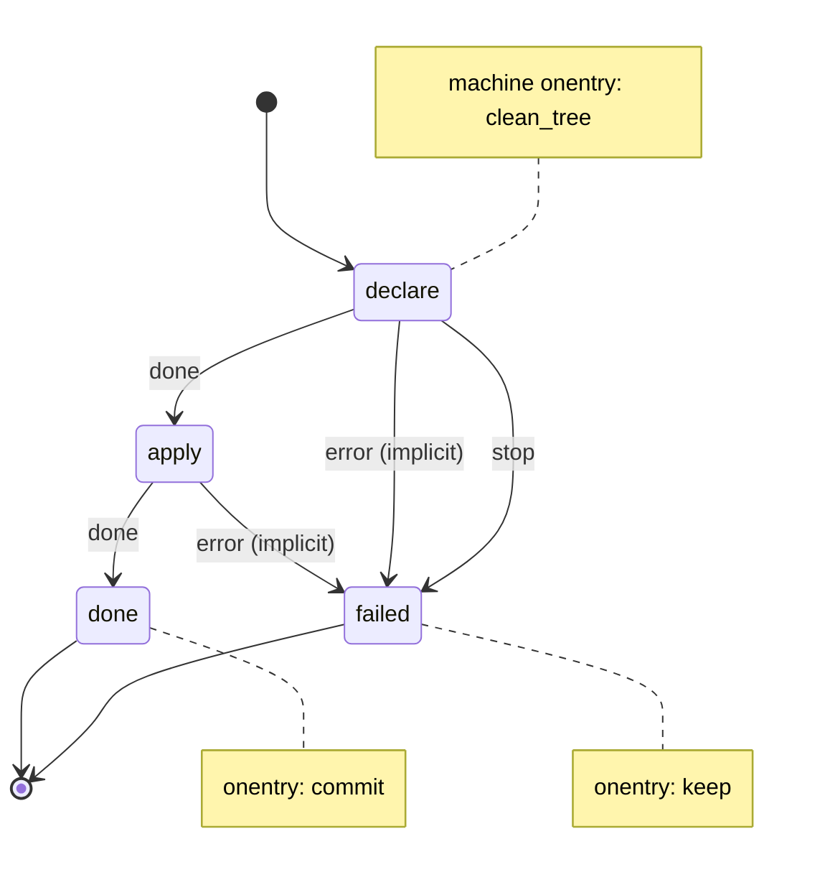

# infra

Add to the environment the project needs, the first time and every time after; Claude declares each resource in lib/infra/requirements, then apply installs what is missing and checks every line.

Machine: [machines/infra.yml](../machines/infra.yml)

