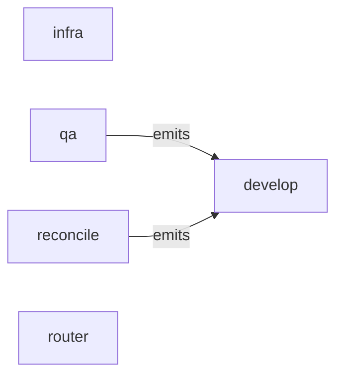

# All machines

Every machine, the `emits` and `invokes` edges between them, and cron entry points.

- [develop](develop.md): Make the repo match a message with Claude, then run the repo's pre-push gate.
- [infra](infra.md): Add to the environment the project needs, the first time and every time after; Claude declares each resource in lib/infra/requirements, then apply installs what is missing and checks every line.
- [qa](qa.md): Attack the project to make it misbehave, and hand each real bug to develop as a failing test; Claude writes tests only and never fixes code.
- [reconcile](reconcile.md): Re-run, through develop, every processed migration that changed since it last landed.
- [router](router.md): Ask Claude to pick one of the options in the request.

