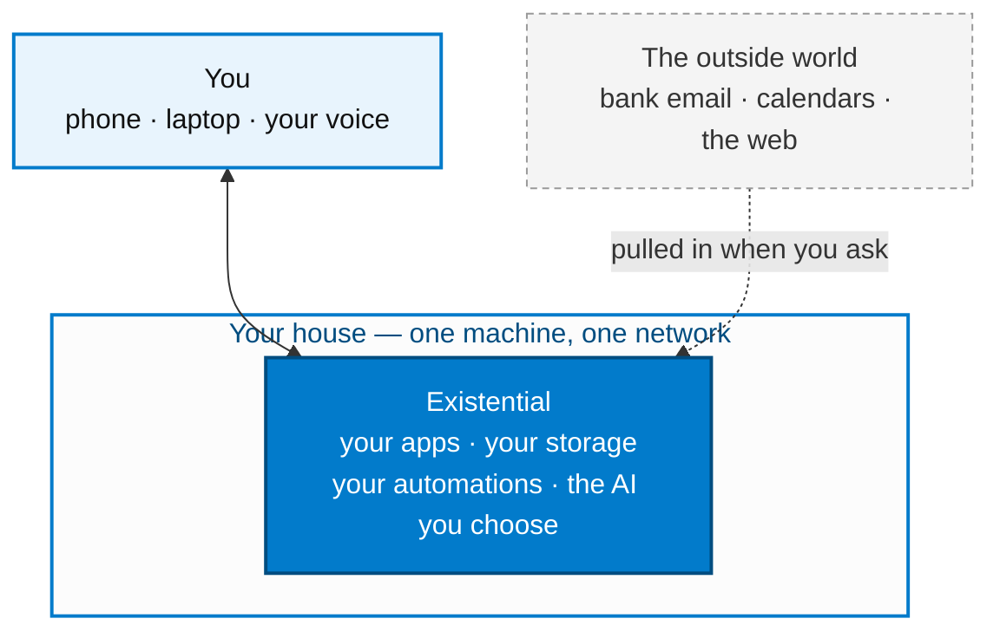
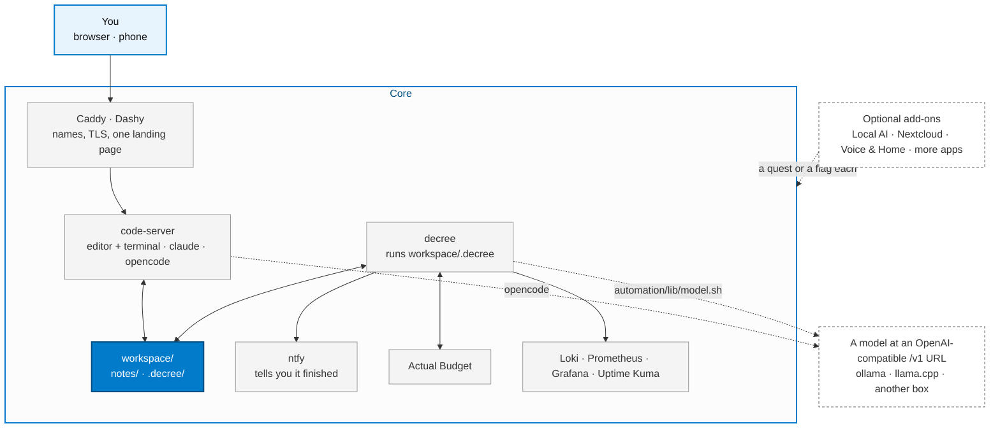

# Existential

**Your best brain day now carries your worst.**

On a clear day you can see exactly what to do. Then the fog rolls in, and the idea sits in a
note you won't open for three weeks. Existential keeps the clear day running. What you decide
when you're sharp becomes an automation that comes to you on its own, on the days you'd never
think to look.

Everything else on your phone surfaces what someone else decided needs your attention. This
surfaces what you decided. What you're building is your Diagram: the plan your best day wrote,
followed on every other one.



- **Written down, not remembered.** A decision is a file. It runs whether or not you remember
  making it.
- **Plain files.** Everything you build is a file you can read. Nothing is locked inside an
  app you'll move on from.
- **Yours, physically.** It runs on hardware you own. No account to lose, no subscription
  required, nobody who can lock you out.

Underneath it is a curated set of open-source apps run as one system on your own hardware, with
an AI of your choice that can act on everything in it.

## 🚀 Quick start

Prerequisites: [Docker](https://www.docker.com/get-started/) usable without sudo, a machine to
host it, and this repo. Everything is reachable from your own network on the first run; reaching
it from outside the house is [any VPN you like](https://existential.company/docs/hosting/vpn).

```bash
git clone https://github.com/jtmckay/existential.git
cd existential

./existential.sh quest      # pick your services
docker compose up -d
```

`./existential.sh` renders each enabled service's templates and merges them into one
`docker-compose.yml` and one `.env` at the repo root. Always run compose from the root, never
from a service folder.

📖 **[Getting Started](https://existential.company/docs/getting-started)** for the full walkthrough.

## What Core installs

The first `quest` offers **Core**: open the work dir, talk to an AI about it, have decree
automate it. Ten services on one ordinary box, no GPU and no model downloads.

| | |
|---|---|
| [code-server](https://existential.company/docs/services/code-server) | The work dir in a browser tab: editor, plus a terminal with `claude` and `opencode` ready |
| [Decree](https://existential.company/docs/decree/) | The automation engine and its webhook: machines run on a schedule, a webhook or an inbox message |
| [ntfy](https://existential.company/docs/services/ntfy) | How a finished automation tells you it finished |
| [Loki](https://existential.company/docs/hosting/loki) · [Prometheus](https://existential.company/docs/hosting/prometheus) · [Grafana](https://existential.company/docs/hosting/grafana) | Every decree run log, searchable, with dashboards wired up |
| [Uptime Kuma](https://existential.company/docs/hosting/uptime-kuma) | Whether the rest of your homelab is up |
| [Actual Budget](https://existential.company/docs/services/actual-budget) | Budgeting, and the first app decree posts to |
| [Caddy](https://existential.company/docs/hosting/caddy) | `https://<service>.<domain>` for every one of them |
| [Dashy](https://existential.company/docs/services/dashy) | One page linking to all of the above |

## How it fits together

You work in one folder, `workspace/`: `notes/` (an Obsidian vault), `.decree/` (your
automations, as machines, scripts and cron files) and `.capture/` (your agent prompts and
anything else you capture, secrets redacted). code-server opens it in a browser; decree runs
what is in `.decree/`, and every morning writes `notes/you-were-here.md`: what is waiting on
you, what is holding steady and where you left off, pushed to your phone through ntfy. A
look back turns those days into what you did this week, month or year. Anything that needs a model reaches it through one OpenAI-compatible `/v1` URL,
served by ollama, llama.cpp or anything else, on this box or another one.



Every service is a folder. Its flag — `EXIST_IS_<CATEGORY>_<SLUG>` — is derived from the path,
so **adding a service is adding a folder**. Disabled services are skipped entirely: no
templates render, no secrets are generated, nothing lands on disk.

📖 **[The Pieces](https://existential.company/docs/how-it-works)** for the whole model.

## Optional add-ons

Everything else is an add-on: a quest (`./existential.sh quest`) or one `EXIST_IS_*` flag, and
none of it is needed for Core to work.

### Local AI

| | |
|---|---|
| [Ollama](https://existential.company/docs/ai/ollama) | Local models, served at the same OpenAI-compatible URL |
| [Hermes](https://existential.company/docs/ai/hermes) | An agent with tools and skills, over that same URL |
| [Open WebUI](https://existential.company/docs/ai/open-web-ui) | Day-to-day chat |
| [OpenViking](https://existential.company/docs/ai/openviking) | Context database — memory, resources, skills |
| [Honcho](https://existential.company/docs/ai/honcho) | Cross-session memory |
| [Firecrawl](https://existential.company/docs/ai/firecrawl) | Web scraping API for agents |
| [WhisperX](https://existential.company/docs/ai/whisperx) | Speech → text, with speaker diarization |
| [Chatterbox](https://existential.company/docs/ai/chatterbox) | Text → speech |
| [ComfyUI](https://existential.company/docs/ai/comfyui) | Image and video generation |
| [MCP](https://existential.company/docs/ai/mcp) | Tool servers for agents |

### Voice & Home

| | |
|---|---|
| [Home Assistant](https://existential.company/docs/services/homeassistant) | Home automation and voice |
| [wyoming-whisper](https://existential.company/docs/ai/wyoming-whisper) · [wyoming-piper](https://existential.company/docs/ai/wyoming-piper) | What Home Assistant listens and speaks with |

### Files

| | |
|---|---|
| [Nextcloud](https://existential.company/docs/storage/nextcloud) | File sync and sharing, or a Nextcloud elsewhere that `workspace/` syncs with |
| [Collabora](https://existential.company/docs/storage/collabora) | Document editing in the browser |
| [Obsidian](https://existential.company/docs/services/obsidian) | The desktop app for `workspace/notes/` (not a container) |

### More apps and tools

| | |
|---|---|
| [Immich](https://existential.company/docs/services/immich) | Photos and video |
| [Mealie](https://existential.company/docs/services/mealie) | Recipes and meal planning |
| [NocoDB](https://existential.company/docs/services/nocodb) | Database as a spreadsheet |
| [Appsmith](https://existential.company/docs/services/appsmith) | Internal tool builder |
| [Lowcoder](https://existential.company/docs/services/lowcoder) | Customer-facing app builder |
| [IT-Tools](https://existential.company/docs/services/it-tools) | Developer odds and ends |
| [pi-hole](https://existential.company/docs/hosting/pihole) | LAN DNS and ad blocking |
| [Portainer](https://existential.company/docs/hosting/portainer) | Container management |
| [Docker log rotation](https://existential.company/docs/hosting/docker) | Caps container logs on the host |

Considered and rejected alternatives, with reasons, live in the
[graveyard](https://existential.company/docs/graveyard/).

## What it does with all that

A **flow** is one complete path from *something happened* to *it was handled*:

- [Note → Action](https://existential.company/docs/flows/note-to-action) — a thought worth chasing gets chased, and comes back with the right questions
- [Camera → OCR](https://existential.company/docs/flows/image-ocr) — photograph something, get back its text
- [Recording → Transcription](https://existential.company/docs/flows/recording-transcription) — recordings become searchable, speaker-labelled text
- [Bank Alert → Budget](https://existential.company/docs/flows/transaction-gmail-actual-budget) — transaction emails become budget entries

📖 **[All flows](https://existential.company/docs/flows/)**

## Docs

The documentation is layered like a [C4 diagram](https://c4model.com/) — each level zooms in one
step, and you can stop at any of them.

| | | |
|---|---|---|
| **Level 1** | [What It Is](https://existential.company/docs/intro) | What this is and what it does for you |
| **Level 2** | [The Pieces](https://existential.company/docs/how-it-works) | What's actually running and how it fits |
| **Level 3** | [Flows](https://existential.company/docs/flows/) | How one job gets done, start to finish |
| **Level 4** | [Build On It](https://existential.company/docs/build-on-it) | The contract to write against |

## Third-party software

This project runs multiple open source projects under their respective licenses. See
[Open Source Notices](https://existential.company/docs/open-source-notices) and the
[licensing audit](https://existential.company/docs/licensing).
