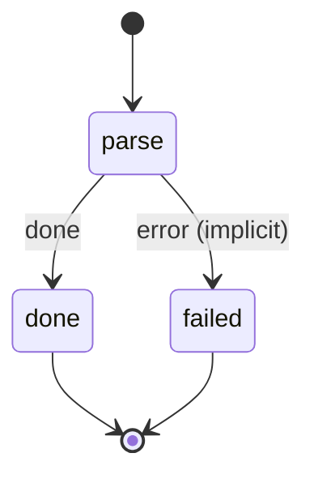

# actual_budget_parse

Run a bank's parse script against one email and emit the transaction it finds to actual_budget.

Machine: [machines/actual_budget_parse.yml](../machines/actual_budget_parse.yml)

