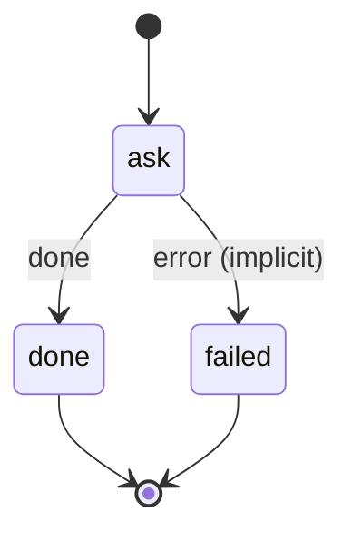

# agent_task

Hand a task to pi on the local model (a department picks its tools) and file the answer in workspace/ai/, then notify.

Machine: [machines/agent_task.yml](../machines/agent_task.yml)

