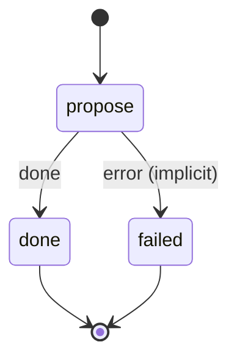

# automation_propose

Write a standing instruction from a note as an automation's migration (its intent and declarative requirements) in notes/automations/proposed/, and tell you.

Machine: [machines/automation_propose.yml](../machines/automation_propose.yml)

