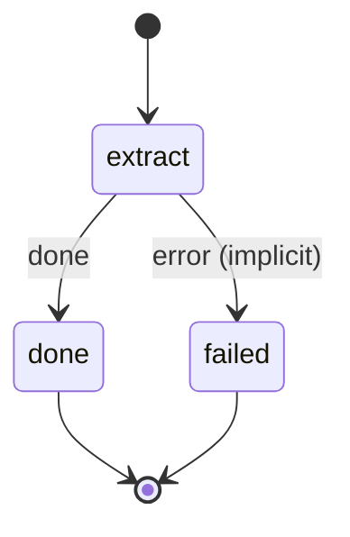

# calendar_extract

Mirror Nextcloud Calendar events in a window around today into workspace/ai/calendar/ as one note per event.

Machine: [machines/calendar_extract.yml](../machines/calendar_extract.yml)

