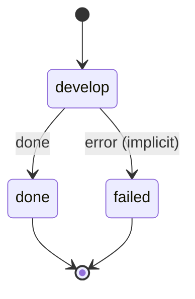

# develop

Build an accepted automation from its migration (notes/automations/<name>.md) - the machine, its script and its trigger - checked by decree check, or undone.

Machine: [machines/develop.yml](../machines/develop.yml)

