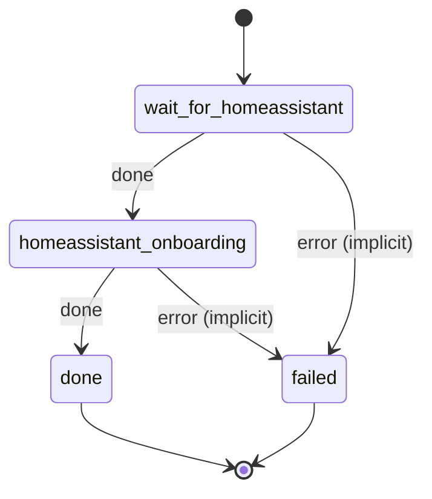

# homeassistant_onboarding

Complete Home Assistant's onboarding by creating the admin account from EXIST_USERNAME.

Machine: [machines/homeassistant_onboarding.yml](../machines/homeassistant_onboarding.yml)

