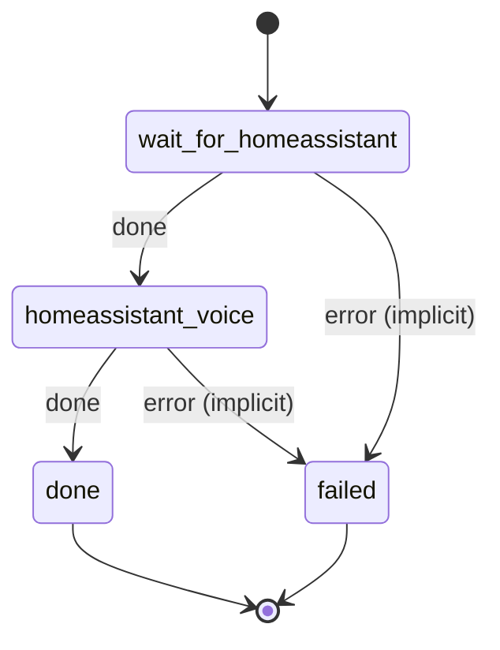

# homeassistant_voice

Wire Wyoming speech-to-text and text-to-speech, and the chat model as the conversation agent, into Home Assistant's Assist pipeline.

Machine: [machines/homeassistant_voice.yml](../machines/homeassistant_voice.yml)

