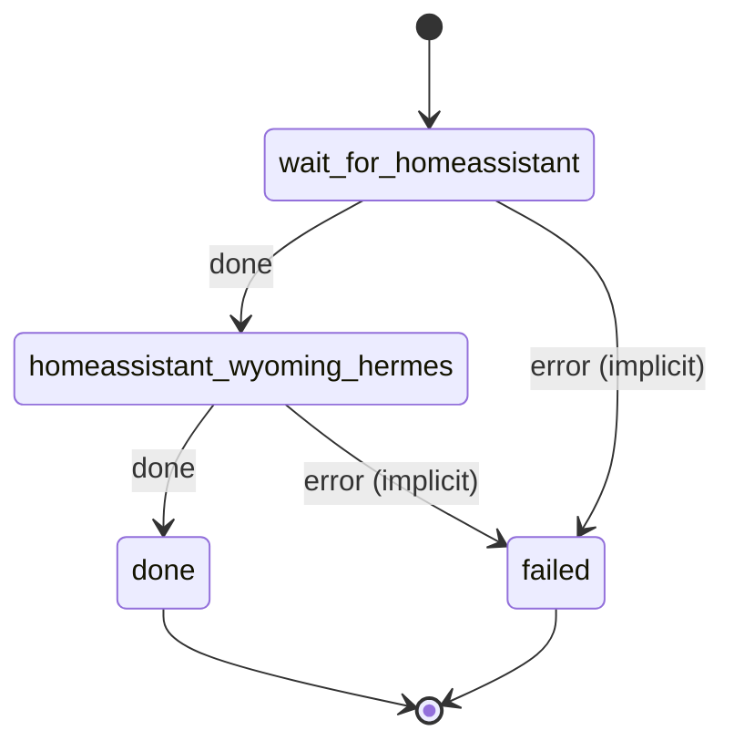

# homeassistant_wyoming_hermes

Wire Wyoming speech-to-text and text-to-speech, and Hermes as the conversation agent, into Home Assistant's Assist pipeline.

Machine: [machines/homeassistant_wyoming_hermes.yml](../machines/homeassistant_wyoming_hermes.yml)

