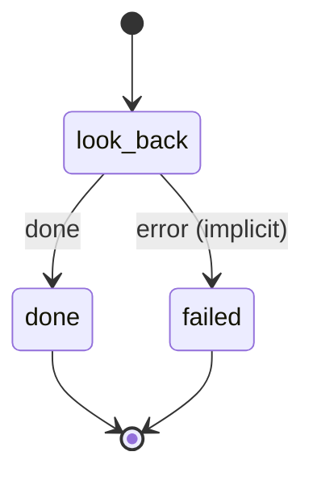

# look_back

A look back over a range of the "you were here" archive, written to workspace/ai/you-were-here/<YYYY>/look-back-<from>-<to>.md and pointed at through ntfy.

Machine: [machines/look_back.yml](../machines/look_back.yml)

