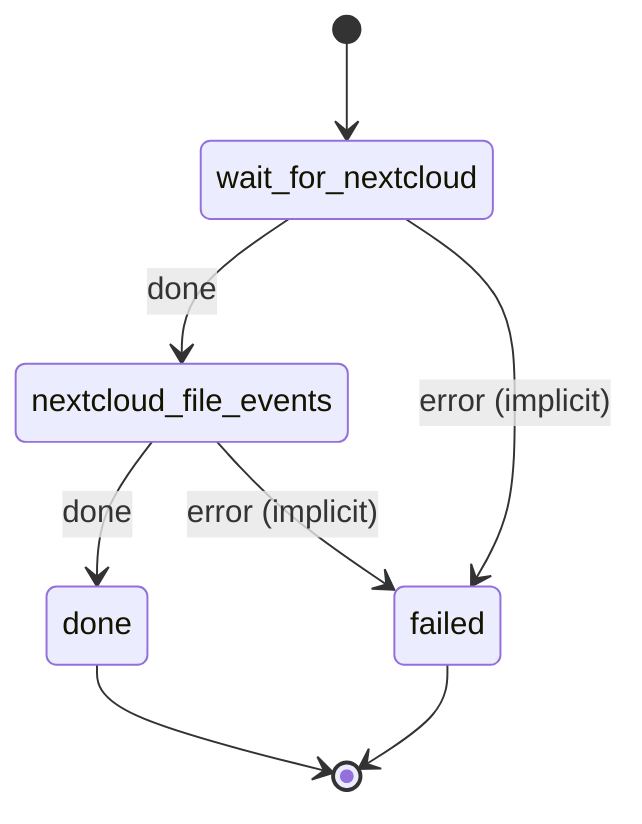

# nextcloud_file_events

Register Nextcloud's file-event webhooks (written, deleted, renamed) against automation-webhook's /files.

Machine: [machines/nextcloud_file_events.yml](../machines/nextcloud_file_events.yml)

