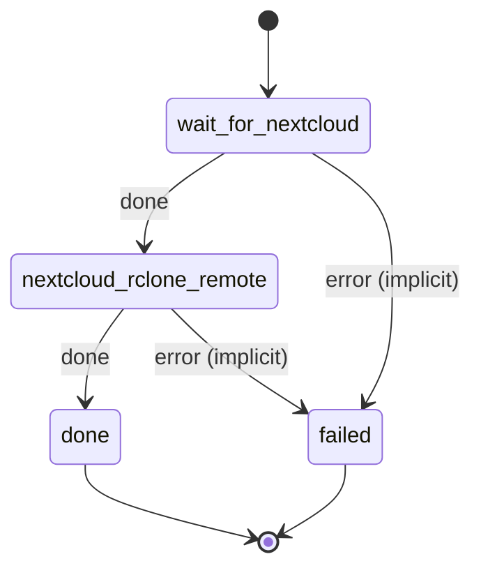

# nextcloud_rclone_remote

Configure the nextcloud rclone remote (WebDAV, admin credentials) that file_processor downloads through.

Machine: [machines/nextcloud_rclone_remote.yml](../machines/nextcloud_rclone_remote.yml)

