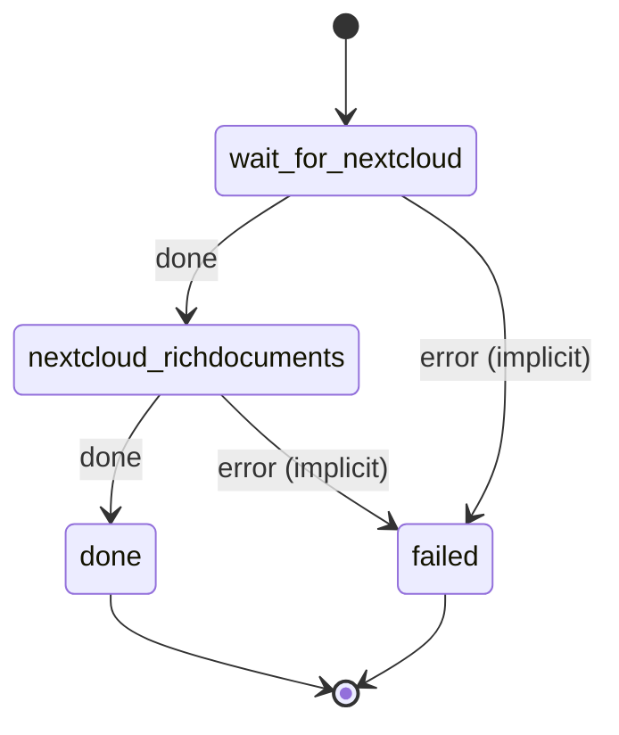

# nextcloud_richdocuments

Install richdocuments and point it at Collabora, with the WOPI allowlist set to the exist bridge.

Machine: [machines/nextcloud_richdocuments.yml](../machines/nextcloud_richdocuments.yml)

