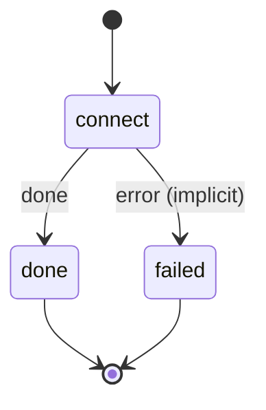

# note_connect

For each new or changed note, ask a hermes department with OpenViking access for one non-obvious connection to what you already know.

Machine: [machines/note_connect.yml](../machines/note_connect.yml)

