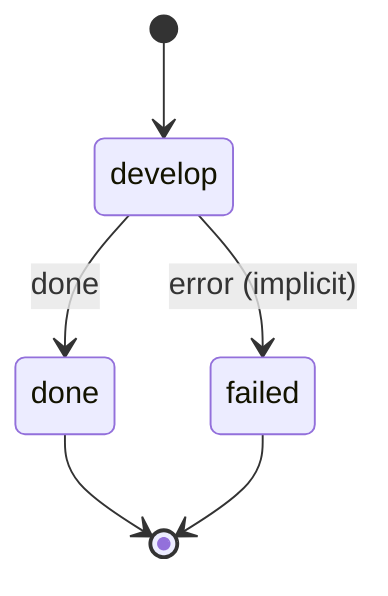

# note_develop

Take one flagged note and draft what can be done without its author, ending with the questions only they can answer.

Machine: [machines/note_develop.yml](../machines/note_develop.yml)

