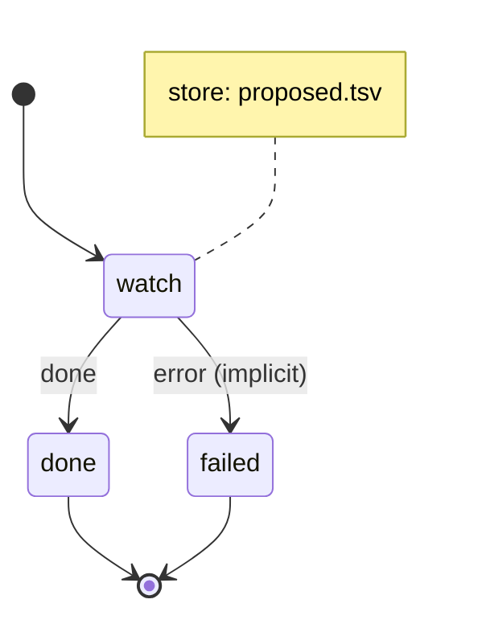

# note_watch

Read one changed note; propose an automation for a standing instruction in it, and start every accepted automation whose trigger it is.

Machine: [machines/note_watch.yml](../machines/note_watch.yml)

