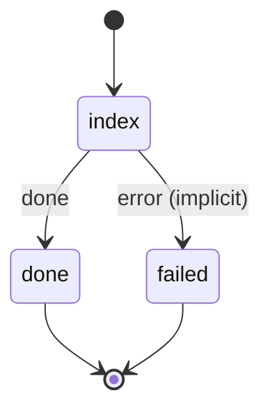

# openviking_index_dir

Upload a directory tree to OpenViking and keep the index in step with it — new, changed and deleted files.

Machine: [machines/openviking_index_dir.yml](../machines/openviking_index_dir.yml)

