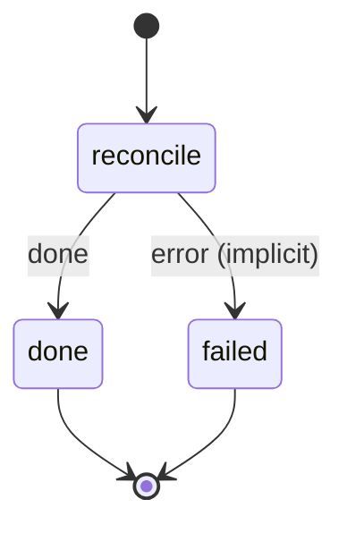

# reconcile

An automation spec in notes/automations/ was accepted, edited or deleted; file it as its migration for develop, re-run it when it changed, or remove what it built.

Machine: [machines/reconcile.yml](../machines/reconcile.yml)

