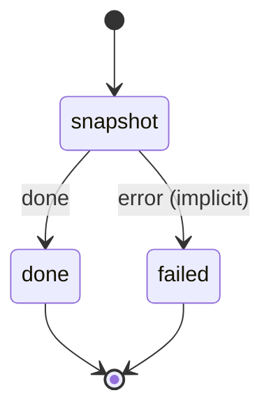

# routines_snapshot

Copy decree's graph, machines and endpoints into workspace/ai/decree/, so hermes knows what it can ask decree for.

Machine: [machines/routines_snapshot.yml](../machines/routines_snapshot.yml)

