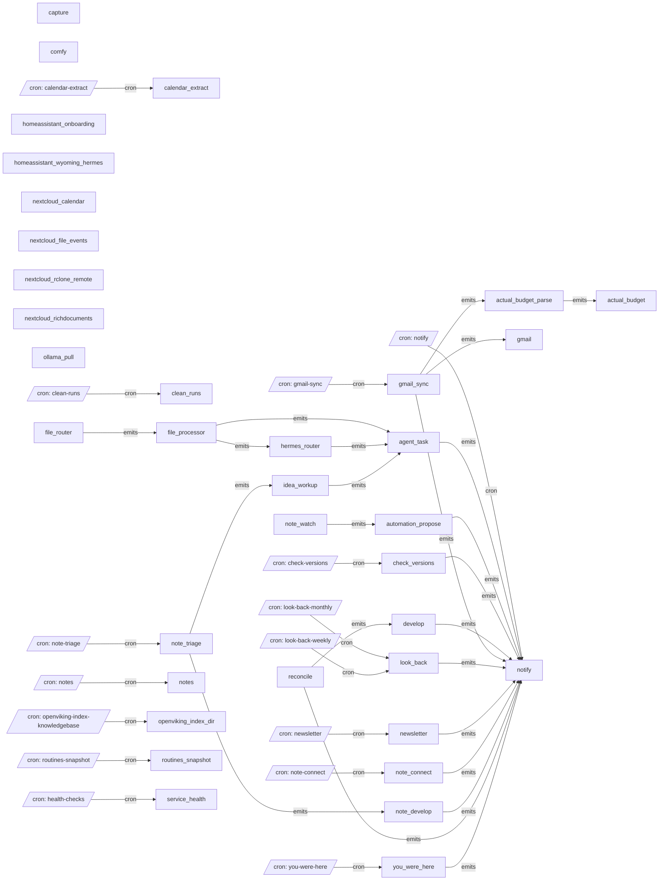

# All machines

Every machine, the `emits` and `invokes` edges between them, and cron entry points.

- [actual_budget](actual_budget.md): Post one transaction to Actual Budget, the amount as the message body.
- [actual_budget_parse](actual_budget_parse.md): Run a bank's parse script against one email and emit the transaction it finds to actual_budget.
- [agent_task](agent_task.md): Hand a task to a hermes profile and file the answer in workspace/ai/, then notify.
- [automation_propose](automation_propose.md): Write a standing instruction from a note as an automation's migration (its intent and declarative requirements) in notes/automations/proposed/, and tell you.
- [calendar_extract](calendar_extract.md): Mirror Nextcloud Calendar events in a window around today into workspace/ai/calendar/ as one note per event.
- [capture](capture.md): Append the message body (JSON {source, text} or plain text) to the capture stream, workspace/.capture/.
- [check_versions](check_versions.md): Compare every pinned image tag against upstream, and notify once when any has an update.
- [clean_runs](clean_runs.md): Delete this project's finished runs older than OLDER_THAN; Loki keeps the history.
- [comfy](comfy.md): Generate an image or video in ComfyUI from a workflow binding in lib/comfy/workflows/, the message body as the prompt.
- [develop](develop.md): Build an accepted automation from its migration (notes/automations/<name>.md) - the machine, its script and its trigger - checked by decree check, or undone.
- [file_processor](file_processor.md): Download one file, put it to the processor's CRITERIA if it has any, then run the processor on it.
- [file_router](file_router.md): Route one Nextcloud file event to every file processor whose PATTERN matches its path.
- [gmail](gmail.md): File one email from gmail_sync, whole, in the emails directory.
- [gmail_sync](gmail_sync.md): Fetch new Gmail messages under one label and emit each to GMAIL_ROUTINE, headers as params and body as body.
- [hermes_router](hermes_router.md): Ask the hermes router profile which department fits a task, then hand it to agent_task on that profile.
- [homeassistant_onboarding](homeassistant_onboarding.md): Complete Home Assistant's onboarding by creating the admin account from EXIST_USERNAME.
- [homeassistant_wyoming_hermes](homeassistant_wyoming_hermes.md): Wire Wyoming speech-to-text and text-to-speech, and Hermes as the conversation agent, into Home Assistant's Assist pipeline.
- [idea_workup](idea_workup.md): Fan one flagged idea out to the research and sales departments as three agent_task questions.
- [look_back](look_back.md): A look back over a range of the "you were here" archive, written to workspace/notes/you-were-here/<YYYY>/look-back-<from>-<to>.md and pointed at through ntfy.
- [newsletter](newsletter.md): Gather new items from my feeds, pick and summarise the ones that fit my taste, and write the issue to workspace/newsletter/.
- [nextcloud_calendar](nextcloud_calendar.md): Install and enable Nextcloud's Calendar app.
- [nextcloud_file_events](nextcloud_file_events.md): Register Nextcloud's file-event webhooks (written, deleted, renamed) against automation-webhook's /files.
- [nextcloud_rclone_remote](nextcloud_rclone_remote.md): Configure the nextcloud rclone remote (WebDAV, admin credentials) that file_processor downloads through.
- [nextcloud_richdocuments](nextcloud_richdocuments.md): Install richdocuments and point it at Collabora, with the WOPI allowlist set to the exist bridge.
- [note_connect](note_connect.md): For each new or changed note, ask a hermes department with OpenViking access for one non-obvious connection to what you already know.
- [note_develop](note_develop.md): Take one flagged note and draft what can be done without its author, ending with the questions only they can answer.
- [note_triage](note_triage.md): Ask the model one yes/no question per new or changed note, and hand the ones that pass to TRIAGE_ROUTINE.
- [note_watch](note_watch.md): Read one changed note; propose an automation for a standing instruction in it, and start every accepted automation whose trigger it is.
- [notes](notes.md): Pull the notes vault from Nextcloud, compile it, index it, and push the result to Dropbox.
- [notify](notify.md): Send the message body to ntfy.
- [ollama_pull](ollama_pull.md): Pull an Ollama model by role (or tag), or rebuild it with a context window; idempotent.
- [openviking_index_dir](openviking_index_dir.md): Upload a directory tree to OpenViking and keep the index in step with it — new, changed and deleted files.
- [reconcile](reconcile.md): An automation spec in notes/automations/ was accepted, edited or deleted; file it as its migration for develop, re-run it when it changed, or remove what it built.
- [routines_snapshot](routines_snapshot.md): Copy decree's graph, machines and endpoints into workspace/ai/decree/, so hermes knows what it can ask decree for.
- [service_health](service_health.md): Probe one service's HTTP endpoint and fail unless it answers with the expected status.
- [you_were_here](you_were_here.md): The "you were here" digest, written to workspace/notes/you-were-here.md and today's archive, pushed through ntfy when something changed.

