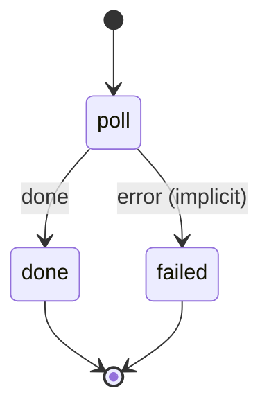

# telegram_ingest

Poll the Telegram bot for new images and save each to an rclone destination, where Nextcloud's file events pick it up.

Machine: [machines/telegram_ingest.yml](../machines/telegram_ingest.yml)

