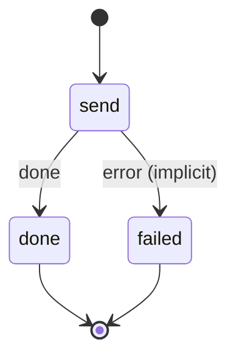

# telegram_notify

Tell Telegram about a new Actual Budget transaction, and remember it so a receipt photo in reply can split it.

Machine: [machines/telegram_notify.yml](../machines/telegram_notify.yml)

