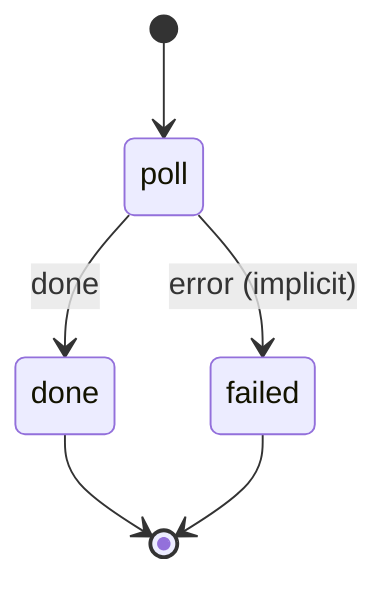

# telegram_receipt

Poll the Telegram bot and route each reply — a receipt photo splits its transaction, "no" reverts a split, any other photo is saved for OCR.

Machine: [machines/telegram_receipt.yml](../machines/telegram_receipt.yml)

