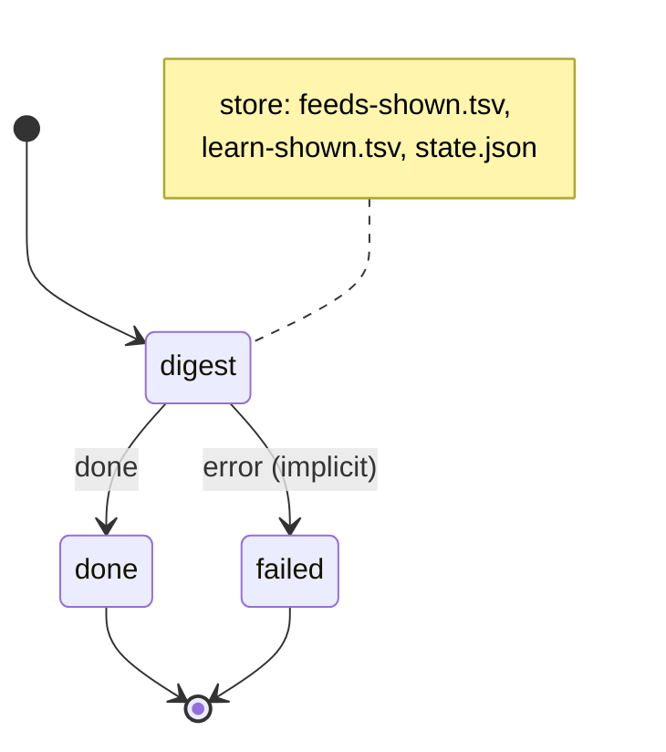

# you_were_here

The "you were here" digest, written to workspace/ai/you-were-here.md and today's archive, pushed through ntfy when something changed.

Machine: [machines/you_were_here.yml](../machines/you_were_here.yml)

