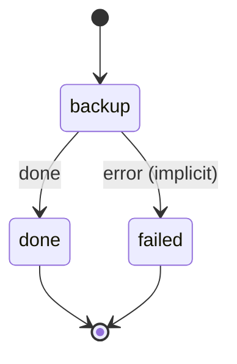

# db_backup

Dump each listed database (postgres, mariadb, mongo), upload the dumps with rclone under the tier, and prune past retention.

Machine: [machines/db_backup.yml](../machines/db_backup.yml)

