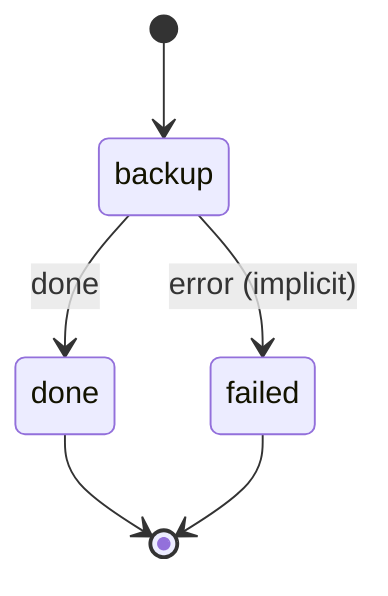

# sqlite_backup

Dump each listed SQLite database with sqlite3 .dump, upload it with rclone under the tier, and prune past retention.

Machine: [machines/sqlite_backup.yml](../machines/sqlite_backup.yml)

