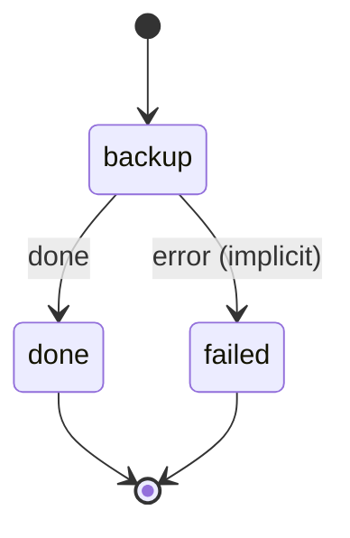

# volume_backup

Tar each listed volume, upload it with rclone to the backup remote under its tier, and prune past the tier's retention.

Machine: [machines/volume_backup.yml](../machines/volume_backup.yml)

