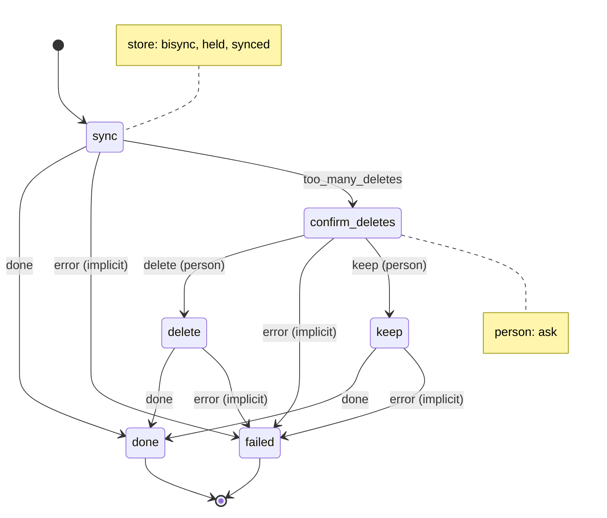

# workspace_sync

Two-way sync workspace/ with a folder in Nextcloud, skipping what any .gitignore ignores and every .git/, and asking a person before a large delete.

Machine: [machines/workspace_sync.yml](../machines/workspace_sync.yml)

