# All machines

Every machine, the `emits` and `invokes` edges between them, and cron entry points.

- [clean_runs](clean_runs.md): Delete this project's finished runs older than OLDER_THAN; Loki keeps the history.
- [db_backup](db_backup.md): Dump each listed database (postgres, mariadb, mongo), upload the dumps with rclone under the tier, and prune past retention.
- [notes_pull](notes_pull.md): Rsync-pull an external notes vault into workspace/notes, one way, without --delete unless asked.
- [notify](notify.md): Send the message body to ntfy, falling back to Telegram when ntfy is unreachable.
- [sqlite_backup](sqlite_backup.md): Dump each listed SQLite database with sqlite3 .dump, upload it with rclone under the tier, and prune past retention.
- [triage](triage.md): Run every enabled service's own exist.test.sh, and notify when one breaks or recovers.
- [volume_backup](volume_backup.md): Tar each listed volume, upload it with rclone to the backup remote under its tier, and prune past the tier's retention.

```mermaid
flowchart LR
    clean_runs["clean_runs"]
    db_backup["db_backup"]
    notes_pull["notes_pull"]
    notify["notify"]
    sqlite_backup["sqlite_backup"]
    triage["triage"]
    volume_backup["volume_backup"]
    cron__actual_budget_volume_backup_nightly[/"cron: actual-budget-volume-backup-nightly"/]
    cron__actual_budget_volume_backup_weekly[/"cron: actual-budget-volume-backup-weekly"/]
    cron__appsmith_volume_backup_nightly[/"cron: appsmith-volume-backup-nightly"/]
    cron__appsmith_volume_backup_weekly[/"cron: appsmith-volume-backup-weekly"/]
    cron__clean_runs[/"cron: clean-runs"/]
    cron__hermes_volume_backup_nightly[/"cron: hermes-volume-backup-nightly"/]
    cron__hermes_volume_backup_weekly[/"cron: hermes-volume-backup-weekly"/]
    cron__honcho_db_backup_nightly[/"cron: honcho-db-backup-nightly"/]
    cron__honcho_db_backup_weekly[/"cron: honcho-db-backup-weekly"/]
    cron__immich_db_backup_nightly[/"cron: immich-db-backup-nightly"/]
    cron__immich_db_backup_weekly[/"cron: immich-db-backup-weekly"/]
    cron__immich_volume_backup_nightly[/"cron: immich-volume-backup-nightly"/]
    cron__immich_volume_backup_weekly[/"cron: immich-volume-backup-weekly"/]
    cron__lowcoder_db_backup_nightly[/"cron: lowcoder-db-backup-nightly"/]
    cron__lowcoder_db_backup_weekly[/"cron: lowcoder-db-backup-weekly"/]
    cron__lowcoder_volume_backup_nightly[/"cron: lowcoder-volume-backup-nightly"/]
    cron__lowcoder_volume_backup_weekly[/"cron: lowcoder-volume-backup-weekly"/]
    cron__mealie_db_backup_nightly[/"cron: mealie-db-backup-nightly"/]
    cron__mealie_db_backup_weekly[/"cron: mealie-db-backup-weekly"/]
    cron__mealie_volume_backup_nightly[/"cron: mealie-volume-backup-nightly"/]
    cron__mealie_volume_backup_weekly[/"cron: mealie-volume-backup-weekly"/]
    cron__nextcloud_db_backup_nightly[/"cron: nextcloud-db-backup-nightly"/]
    cron__nextcloud_db_backup_weekly[/"cron: nextcloud-db-backup-weekly"/]
    cron__nocodb_db_backup_nightly[/"cron: nocodb-db-backup-nightly"/]
    cron__nocodb_db_backup_weekly[/"cron: nocodb-db-backup-weekly"/]
    cron__nocodb_volume_backup_nightly[/"cron: nocodb-volume-backup-nightly"/]
    cron__nocodb_volume_backup_weekly[/"cron: nocodb-volume-backup-weekly"/]
    cron__notes_pull[/"cron: notes-pull"/]
    cron__openviking_volume_backup_nightly[/"cron: openviking-volume-backup-nightly"/]
    cron__openviking_volume_backup_weekly[/"cron: openviking-volume-backup-weekly"/]
    cron__triage[/"cron: triage"/]
    cron__uptime_kuma_sqlite_backup_nightly[/"cron: uptime-kuma-sqlite-backup-nightly"/]
    cron__uptime_kuma_sqlite_backup_weekly[/"cron: uptime-kuma-sqlite-backup-weekly"/]
    cron__workspace_volume_backup_nightly[/"cron: workspace-volume-backup-nightly"/]
    cron__workspace_volume_backup_weekly[/"cron: workspace-volume-backup-weekly"/]
    cron__actual_budget_volume_backup_nightly -->|cron| volume_backup
    cron__actual_budget_volume_backup_weekly -->|cron| volume_backup
    cron__appsmith_volume_backup_nightly -->|cron| volume_backup
    cron__appsmith_volume_backup_weekly -->|cron| volume_backup
    cron__clean_runs -->|cron| clean_runs
    cron__hermes_volume_backup_nightly -->|cron| volume_backup
    cron__hermes_volume_backup_weekly -->|cron| volume_backup
    cron__honcho_db_backup_nightly -->|cron| db_backup
    cron__honcho_db_backup_weekly -->|cron| db_backup
    cron__immich_db_backup_nightly -->|cron| db_backup
    cron__immich_db_backup_weekly -->|cron| db_backup
    cron__immich_volume_backup_nightly -->|cron| volume_backup
    cron__immich_volume_backup_weekly -->|cron| volume_backup
    cron__lowcoder_db_backup_nightly -->|cron| db_backup
    cron__lowcoder_db_backup_weekly -->|cron| db_backup
    cron__lowcoder_volume_backup_nightly -->|cron| volume_backup
    cron__lowcoder_volume_backup_weekly -->|cron| volume_backup
    cron__mealie_db_backup_nightly -->|cron| db_backup
    cron__mealie_db_backup_weekly -->|cron| db_backup
    cron__mealie_volume_backup_nightly -->|cron| volume_backup
    cron__mealie_volume_backup_weekly -->|cron| volume_backup
    cron__nextcloud_db_backup_nightly -->|cron| db_backup
    cron__nextcloud_db_backup_weekly -->|cron| db_backup
    cron__nocodb_db_backup_nightly -->|cron| db_backup
    cron__nocodb_db_backup_weekly -->|cron| db_backup
    cron__nocodb_volume_backup_nightly -->|cron| volume_backup
    cron__nocodb_volume_backup_weekly -->|cron| volume_backup
    cron__notes_pull -->|cron| notes_pull
    cron__openviking_volume_backup_nightly -->|cron| volume_backup
    cron__openviking_volume_backup_weekly -->|cron| volume_backup
    cron__triage -->|cron| triage
    cron__uptime_kuma_sqlite_backup_nightly -->|cron| sqlite_backup
    cron__uptime_kuma_sqlite_backup_weekly -->|cron| sqlite_backup
    cron__workspace_volume_backup_nightly -->|cron| volume_backup
    cron__workspace_volume_backup_weekly -->|cron| volume_backup
    triage -->|emits| notify
```

