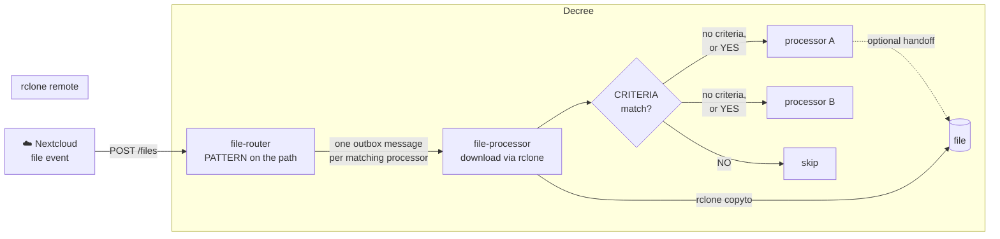

# File Processor

:::info[Mechanism, not a flow]
This is the plumbing a [flow](../flows/) sits on: how a file landing in storage becomes a
running routine. If you are here to see what the system *does*, start at
[Level 3 · Flows](../flows/). If you are wiring up your own, this and
[Build On It](../build-on-it) are the pages you want.
:::

React to files being created, updated, renamed or deleted in Nextcloud. When a file event arrives at the Decree webhook, `file-router` matches the file path against registered processors and fans out one `file-processor` job per match. Each job downloads the file (or generates a share link if `IS_PRE_SIGNED=true`), runs the processor, and deletes the local copy.

A processor declares up to two tests. `PATTERN` is a regex over the path — cheap, mechanical, evaluated by the router. `CRITERIA` is optional: a plain-English test of the file's *content*, put to the model by `file-processor` after the download. Splitting them that way means the expensive half only runs for files that already passed the free one. A processor with no `CRITERIA` behaves exactly as processors did before it existed.



## How It Works

### 1. Nextcloud fires the event

Nextcloud's built-in `webhook_listeners` app does the sending. The `nextcloud-file-events`
migration registers three webhooks against `http://automation-webhook:8801/files`, and every
upload through Nextcloud — desktop client, web UI, mobile app, WebDAV, rclone — queues one:

```json
{
  "event": {
    "node": { "id": 91, "path": "/admin/files/workspace/notes/plan.md" },
    "class": "OCP\\Files\\Events\\Node\\NodeWrittenEvent"
  },
  "user": { "uid": "admin", "displayName": "admin" },
  "time": 1790362082
}
```

`NodeWrittenEvent` covers a new file *and* an overwrite; `NodeDeletedEvent` has the same shape;
`NodeRenamedEvent` carries `source` and `target` instead of `node`. The webhook is sent by a
background job, which the `nextcloud-cron` container delivers as soon as it is queued. A
delivery that fails is logged by Nextcloud and not retried.

The request includes `Authorization: Bearer <EXIST_DECREE_FILES_WEBHOOK_AUTH_TOKEN>`.

:::warning[Only uploads through Nextcloud fire]
Hermes, code-server and decree write the workspace straight to disk. Nextcloud notices those
files (so your desktop client gets them) but raises **no event** for them. That is what stops
an agent's own output from triggering another run.
:::

### 2. file-router — match and fan out

`file-router` strips the `/<user>/files/` prefix, constructs `FILE_SOURCE` as
`nextcloud:<path>` (e.g. `nextcloud:workspace/notes/plan.md`), and scans every script in
`automation/lib/file-processors/` for a `PATTERN=` regex match. It maps written → `created`,
deleted → `removed`, and splits a rename into a removal of the old path plus a creation of the
new one. It also reads each processor's `IS_PRE_SIGNED=` setting to carry it into the job.

A payload does not say whether the path is a file or a folder, and a new folder raises
`NodeWrittenEvent` too. Anchor a `PATTERN` on an extension and you never notice.

For each matching processor it writes one message to the Decree outbox:

```yaml
---
routine: file-processor
rclone_path: "nextcloud:workspace/notes/plan.md"
processor: my-processor
file_action: created
is_pre_signed: false
---
```

Multiple processors can match the same file — each runs independently as a separate Decree message.

### 3. file-processor — download (or reference), run, clean up

`file-processor` exports the standard `FILE_*` env vars, runs the matched processor script, then deletes any local temp file.

- **Default (`IS_PRE_SIGNED=false`)**: downloads the file via `rclone copyto` to a temp path; `FILE_PATH` is the local file.
- **Pre-signed (`IS_PRE_SIGNED=true`)**: skips the download and instead calls `rclone link` to generate a share link; `PRE_SIGNED_URL` is set to that URL and `FILE_PATH` remains empty. Useful when the processor needs to hand off the file to an external service rather than read it locally.
- **`removed` events**: download is always skipped; `FILE_PATH` is empty.

## Adding a File Processor

Create `automation/lib/file-processors/<name>.sh`:

```bash
#!/usr/bin/env bash
# PATTERN is matched against FILE_SOURCE: "nextcloud:<path in Nextcloud>"
PATTERN="^nextcloud:documents/.*\.pdf$"
# CRITERIA is optional. Empty = the path match is the whole test.
CRITERIA=""
IS_PRE_SIGNED=false

set -euo pipefail

if [ "$FILE_ACTION" = "removed" ]; then
    echo "Deleted: $FILE_KEY"
    exit 0
fi

# FILE_PATH is the local temp file (do not delete — file-processor handles cleanup).
# PRE_SIGNED_URL is set instead of FILE_PATH when IS_PRE_SIGNED=true.
echo "Processing $FILE_PATH"

# your logic here — ask hermes (lib/hermes.sh), run a script, POST to an API, etc.
```

**Available env vars:**

| Variable | Example | Description |
|---|---|---|
| `FILE_SOURCE` | `nextcloud:docs/file.pdf` | Full rclone source path |
| `FILE_KEY` | `docs/file.pdf` | Path after the `remote:` prefix |
| `FILE_ACTION` | `created` \| `removed` | Event type |
| `FILE_PATH` | `/tmp/file.pdf.xK3rQp` | Local temp file (empty for `removed` or when `IS_PRE_SIGNED=true`) |
| `PRE_SIGNED_URL` | `https://…` | Share link (set when `IS_PRE_SIGNED=true`, otherwise empty) |
| `FILE_MATCH_REASON` | `Names a vendor and a due date` | The model's one-line reason the criteria gate passed (empty when `CRITERIA` is unset) |

**Script settings:**

| Setting | Default | Description |
|---|---|---|
| `PATTERN` | *(required)* | Regex matched against `FILE_SOURCE` |
| `CRITERIA` | *(empty)* | Plain-English test of the file's content; empty means the path match is the whole test |
| `IS_PRE_SIGNED` | `false` | If `true`, skip download and set `PRE_SIGNED_URL` instead |

**Pattern tips:**

```bash
PATTERN="^nextcloud:Photos/.*\.(jpg|jpeg|png)$"   # one folder + extension
PATTERN="^nextcloud:.*\.pdf$"                      # anywhere, PDFs only
PATTERN="^nextcloud:workspace/.*\.md$"             # markdown in the workspace
PATTERN=".*\.csv$"                                 # any rclone remote, CSVs
```

Decree picks up the new file immediately — no restart needed.

## Setup

:::note[Already done by Core]
The Core quest copies both migrations below. Read on if you set up by hand, or want to know
what is happening under the hood.
:::

Two decree migrations, copied from `automation-examples/migrations/` into
`automation/migrations/`:

- **`23-nextcloud-rclone-remote.md`** — the `nextcloud` rclone remote (WebDAV, as the admin
  user) that `file-processor` downloads through. `rclone_src` on the webhook's `/files` route
  names it.
- **`27-nextcloud-file-events.md`** — registers the three webhooks.

Nextcloud's own side needs nothing: `nas/nextcloud/hooks/before-starting/02-workspace.sh` sets
`allow_local_remote_servers` (without it Nextcloud refuses to POST to a private address), and
`nextcloud-cron` runs the background jobs that actually send the webhooks.

## Testing

Upload a file and watch it route:

```bash
docker exec automation sh -c 'printf hello | curl -fsS -u "$NEXTCLOUD_ADMIN_USER:$NEXTCLOUD_ADMIN_PASSWORD" \
  -T - "http://nextcloud/remote.php/dav/files/$NEXTCLOUD_ADMIN_USER/hello.txt"'
docker logs -f automation
```

Or send a test event directly to the webhook, skipping Nextcloud:

```bash
# automation-webhook publishes no host port — it is reached over the exist
# bridge, so send the event from a container already on it.
docker exec automation curl -X POST http://automation-webhook:8801/files \
  -H "Authorization: Bearer <EXIST_DECREE_FILES_WEBHOOK_AUTH_TOKEN from .env.shared>" \
  -H "Content-Type: application/json" \
  -d '{"event":{"node":{"path":"/admin/files/documents/hello.txt"},"class":"OCP\\Files\\Events\\Node\\NodeWrittenEvent"}}'
```

Inspect the run log after it completes:

```bash
docker exec automation decree status
docker exec automation decree log <id-prefix>
```

## Verifying Routine Pre-checks

```bash
docker exec automation decree routine file-router
docker exec automation decree routine file-processor
```

## Matching on content, not just path

Add a `CRITERIA` line and `file-processor` puts the downloaded file to the model
before running your script:

```bash
PATTERN="^nextcloud:workspace/.*\.md$"
CRITERIA="an open question the author has not resolved"
```

The gate is deliberately stingy — it answers `NO` unless the document genuinely
matches, because a `YES` usually costs a full agent run downstream. On a match,
`FILE_MATCH_REASON` carries the model's one-line reason into your script.

Three things to know:

- **It costs one model call per file that got past `PATTERN`.** Keep the pattern
  narrow enough that the gate is not asked about everything.
- **It only works on text.** For `IS_PRE_SIGNED=true` processors and for
  `removed` events there is nothing on disk to judge, so the gate is skipped and
  the processor runs on the path match alone.
- **No answer is not the same as no match.** If the gateway is down or times out,
  `file-processor` fails the message so Decree retries it, rather than silently
  dropping the file — which would look exactly like a clean `NO`.

## Handing off to an agent

A processor's real job is usually to decide *that* something should happen, not
to do it. `agent-task` is the routine that does it: it calls the hermes gateway
and files the answer in `workspace/ai/`.

```bash
cat > "${OUTBOX_DIR}/handoff-$(date +%s%N).md" << MSG
---
routine: agent-task
file_path: notes/plan.md
output_name: plan-followup
prompt: Read this note and work out what can be settled without the author.
---
MSG
```

Because hermes is an agent gateway that runs its own tool loop, the task inherits
every MCP server hermes has registered: OpenViking search, Firecrawl web search,
Playwright. The prompt does not name tools; it says what it wants, and hermes
decides what to reach for. The gateway is called directly rather than through
OpenCode — [why](./routing#why-not-opencode).

`agent-task` needs `HERMES_API_KEY` (passed through once hermes is enabled), `curl`
and `jq`, and `/workspace/ai` mounted into the decree container.

## Triggering on workspace edits

The workspace (`volumes/workspace_data`) is mounted into Nextcloud as the `workspace` folder,
so editing a note in the Nextcloud desktop client *is* an upload, and fires straight away. There
is no sync routine and no second copy — see [Getting Started](../getting-started#workspace).

`workspace/ai/` is where `agent-task` writes. It is written straight to disk, so it shows up on
your devices and is indexed by OpenViking, but it can never trigger a run.

## Triggering decree from workspace/ — the outbox

Hermes (and anything else confined to `workspace/`) has no mount into
`automation/` and shouldn't get one — routine scripts are read-only from
inside the decree daemon on purpose. `workspace/outbox/` is the one supported
way in: drop a markdown file there and the `outbox-relay` routine (every minute,
activated by Core) turns it into a real decree message.

```markdown
---
routine: agent-task
prompt: Summarize this week's notes.
correlation_id: D0002-1939-triage-0
---
```

`routine` is required — `workspace/ai/decree-routines.md` (kept current by the
`routines-snapshot` routine) lists what's enabled and its parameters. Any
other frontmatter field is forwarded as a parameter to that routine.
`correlation_id` is optional and free-form: a routine invoked from a decree
workflow has one in its environment (see `agent-task.sh`), and passing it
along lets whatever eventually reads the result trace it back to what started
the flow. It is not decree's own `chain` — every relayed message still gets
its own fresh chain — just a plain tag carried between messages. It is also
picked up by decree's own Loki logging whenever a message sets it, so
`{job="decree"} |= "correlation_id=<value>"` in Grafana shows every step of
one flow even though each step ran as its own separate chain.

A few things worth knowing about the relay itself:

- **It deletes what it relays**, so the directory is a real outbox — empty once
  its mail is sent — rather than an accumulating log.
- **A file still being written is left for the next tick** — anything modified
  in the last five seconds waits.
- **A non-message file is left alone.** Only a file whose first line is `---` is
  treated as a message; a README that merely shows the format is skipped. One
  with a missing or invalid `routine` is renamed to `<name>.rejected`, so it is
  reported once rather than every minute.
