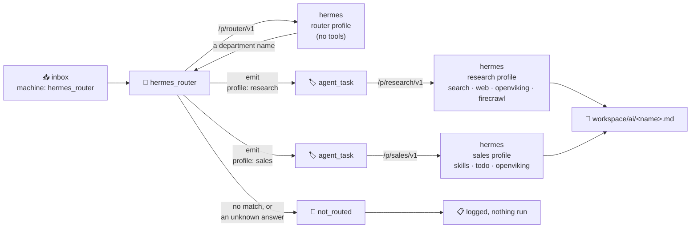

# Routing to Departments

:::info[Mechanism, not a flow]
This is the plumbing under agent work: how a task becomes a *particular* agent's task. If you
are here to see what the system does, start at [Level 3 · Flows](../flows/).
:::

A task arrives with no idea who should handle it. `hermes_router` reads it, names one
department, and emits a decree message naming that department. The department answers with its
own tools and files the result in `workspace/ai/`.

There is one machine for all of them — `agent_task` — because a department's identity is not
code. It is a profile definition in `ai/hermes/profiles/<name>/profile.yml`, and *that* is what
both the router and hermes itself read.



## Why route at all

A hermes profile is its own `HERMES_HOME`: its own `config.yaml`, `.env`, `SOUL.md` and
`skills/`. With `GATEWAY_MULTIPLEX_PROFILES` set, every profile is served off the one listener
at `/p/<name>/v1`, so a caller picks a profile — and therefore a toolset and an MCP server list
— by URL alone.

That matters because tool schemas are the expensive axis of a hermes prompt. Measured on this
stack:

| Profile | Fixed prompt | Tools |
|---|---|---|
| default | ~69 KB (~17,000 tokens) | 21 |
| research | ~15 KB | 4 toolsets + firecrawl |
| sales | ~15 KB | 2 toolsets |
| router | ~2.6 KB (~650 tokens) | 0 |

A skill costs about 76 bytes in the always-on index; a tool schema costs about 2.4 KB. So the
lever is *tools*, not agents — a department can hold thirty agents for the price of one tool.
Routing on the tool-free profile is what makes it cheap enough to run on every message.

## Adding a department

A department is one directory in `ai/hermes/profiles/`. Create
`ai/hermes/profiles/legal/profile.yml`:

```yaml
description: Contracts, terms, licensing questions, and compliance review.
toolsets: skills, todo
mcp: openviking
```

Then `docker compose up -d hermes-agent`. That is the whole job.

Those three keys are the whole registration, and they are read by exactly two things:
`ai/hermes/entrypoint.sh` creates the matching hermes profile on boot, and `hermes_router`
reads the same file — over a read-only mount of `ai/hermes/profiles` — to build the list it
chooses from. No machine to write, no registry, no router edit, and no second copy of the description to
drift.

Write `description` as the answer to *"when should work come here?"*. It is the only thing the
router sees, so a vague one produces vague routing.

## Provisioning the profiles

Nothing to run — `ai/hermes/entrypoint.sh` provisions every profile in `ai/hermes/profiles/`
when the container starts.

That is the only place it *can* happen, and the reason is worth knowing before you go looking
for a migration to do it with: profiles are created by the hermes CLI writing into the
container's own data volume, so the host would need `docker exec` and decree cannot reach them
at all — it has no Docker socket, and it sees the repo read-only. Config a service owns, written
by that service's entrypoint, is the repo's standing answer for exactly this shape.

Idempotent and never destructive: an existing profile keeps its `config.yaml`. To rebuild one
after changing its definition, delete `volumes/hermes_agent_data/profiles/<name>` and restart
hermes.

Each profile gets its own `API_SERVER_KEY`. Secondary profiles do not borrow the default
profile's credential — a profile without one returns 401 on every request, and an unknown
profile name returns 404 rather than quietly falling through to the default.

To see what a profile costs:

```
docker exec -e HERMES_HOME=/opt/data/profiles/research hermes-agent \
  /opt/hermes/.venv/bin/hermes prompt-size
```

## Sending work

Emit a message for `hermes_router`:

```bash
echo 'Find out who already sells this, and how they position against each other.' \
  | docker exec -i automation decree emit --machine hermes_router \
      --param source_file=notes/competitors.md --param output_name=competitor-scan
```

Or skip the router and address a department directly with `--machine agent_task --param
profile=research` — the same machine the router would have emitted, no routing call. A file
processor does this by emitting the message itself; see
[File Processor](./file-change-processing).

## When routing fails

`hermes_router` never guesses. The reply is validated against the discovered department list,
and anything else — an empty answer, a gateway timeout, a hallucinated name, or an honest
`none` — ends the run in `not_routed`, with the reason, the candidates and the source in its
log. Nothing else runs for that message.

A message that names no machine, or one this project does not have, never reaches the router
at all: decree records it as a `failed` run with `invalid_message`, and Grafana alerts on it.

## Why not OpenCode

Departments call the hermes endpoint directly — through `automation/lib/hermes.sh`, like every
other script — and the stack ships no AI CLI at all. Hermes is itself an agent running its own
tool loop against its own MCP servers, so OpenCode was an agent wrapping an agent, and its
streaming parser rejects hermes' custom `event: hermes.tool.progress` SSE frames outright, which
fails every turn where hermes actually uses a tool.

That is also why pointing a coding agent at the gateway is not the way to work on this stack.
Change the stack with a dedicated coding agent against a frontier model, on the machine that
holds the repo; the gateway gets the work it is good at, on `workspace/`. In a script that is
`hermes_chat`/`hermes_gate`; in a terminal it is the `hermes` command that
[code-server](../services/code-server) puts on `PATH`.
