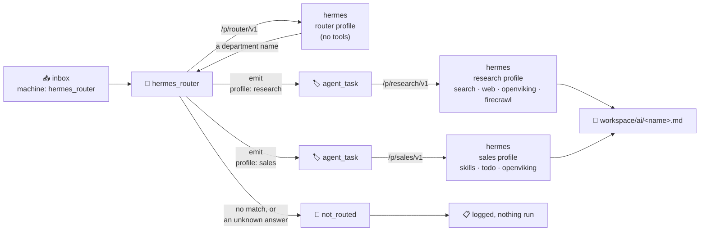

# Routing to Departments

:::info[Mechanism, not a flow]
How a task reaches a particular agent. For what the system does, see [Flows](../flows/).
:::

- `hermes_router` reads a task, picks one department, and emits a message for it.
- The department answers with its own tools and writes the result to `workspace/ai/`.
- One machine, `agent_task`, serves every department. A department is a profile file,
  `ai/hermes/profiles/<name>/profile.yml`, read by both the router and hermes.



## Why route at all

Each hermes profile has its own config, skills and tools, served at `/p/<name>/v1`. Tool schemas
are what make a prompt expensive:

| Profile | Fixed prompt | Tools |
|---|---|---|
| default | ~69 KB (~17,000 tokens) | 21 |
| research | ~15 KB | 4 toolsets + firecrawl |
| sales | ~15 KB | 2 toolsets |
| router | ~2.6 KB (~650 tokens) | 0 |

A skill costs about 76 bytes; a tool schema about 2.4 KB. The router profile has no tools, so
routing is cheap enough for every message.

## Adding a department

A department is one directory in `ai/hermes/profiles/`. Create
`ai/hermes/profiles/legal/profile.yml`:

```yaml
description: Contracts, terms, licensing questions, and compliance review.
toolsets: skills, todo
mcp: openviking
```

Then `docker compose up -d hermes-agent`.

- `ai/hermes/entrypoint.sh` creates the profile on boot; `hermes_router` reads the same file to
  build its list.
- Write `description` as the answer to "when should work come here?". It's all the router sees.

## Provisioning the profiles

`ai/hermes/entrypoint.sh` provisions every profile in `ai/hermes/profiles/` on start. Decree
can't do it: profiles live in the container's own volume.

- An existing profile keeps its `config.yaml`. To rebuild one, delete
  `volumes/hermes_agent_data/profiles/<name>` and restart hermes.
- Each profile has its own `API_SERVER_KEY`. A profile without one returns 401; an unknown name
  returns 404.

To see what a profile costs:

```
docker exec -e HERMES_HOME=/opt/data/profiles/research hermes-agent \
  /opt/hermes/.venv/bin/hermes prompt-size
```

## Sending work

Emit a message for `hermes_router`:

```bash
echo 'Find out who already sells this, and how they position against each other.' \
  | docker exec -i automation decree emit --machine hermes_router \
      --param source_file=notes/competitors.md --param output_name=competitor-scan
```

To skip the router: `--machine agent_task --param profile=research`. A
[file processor](./file-change-processing) can emit that message itself.

## When routing fails

- A reply that isn't a known department (empty, timeout, made up, or `none`) ends in
  `not_routed`, with the reason logged. Nothing else runs.
- A message naming no machine, or an unknown one, fails as `invalid_message`, and Grafana alerts.

## Why not OpenCode

- Departments call hermes directly through `automation/lib/hermes.sh`.
- OpenCode's streaming parser rejects hermes' `event: hermes.tool.progress` SSE frames, which
  fails every turn where hermes uses a tool.
- code-server's `claude` and `opencode` point at a model, not at hermes.
- Change the stack with a coding agent on the host. Use hermes on `workspace/`: `hermes_chat` in a
  script (`model_chat`/`model_gate` for a plain completion), or the `hermes` command in
  [code-server](../services/code-server).
