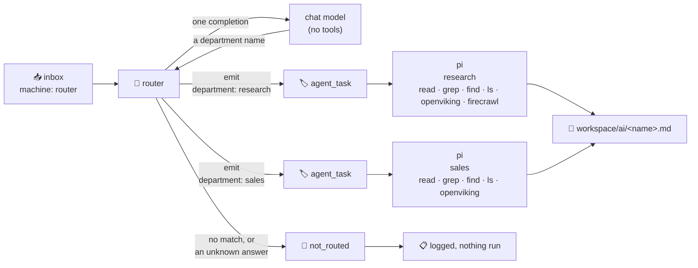

# Routing to Departments

:::info[Mechanism, not a flow]
How a task reaches a particular agent. For what the system does, see [Flows](../flows/).
:::

- `router` reads a task, picks one department, and emits a message for it.
- The department answers with its own tools and writes the result to `workspace/ai/`.
- One machine, `agent_task`, serves every department. A department is a file,
  `workspace/.decree/lib/departments/<name>.yml`, read by both the router and [pi](../ai/pi).



## Why route at all

A department is what one run may reach. Tool schemas are what make an agent's prompt expensive
on a local model, and a run that only needs to search should not carry a browser or a shell. So
each department names its own tools, and the decision itself is a single completion with no
tools at all — cheap enough for every message.

## Adding a department

Create `workspace/.decree/lib/departments/legal.yml`:

```yaml
description: Contracts, terms, licensing questions, and compliance review.
tools: read, grep, find, ls
mcp: openviking
```

Nothing restarts: the next run reads it.

- `tools` are pi's built-ins (`read`, `bash`, `edit`, `write`, `grep`, `find`, `ls`); `mcp` names
  servers [pi_configure](../ai/pi#what-it-talks-to) registers while their add-on is on
  (`openviking`, `firecrawl`, `playwright`, `qmd`). Blank means none.
- Write `description` as the answer to "when should work come here?". It's all the router sees.

## Sending work

Emit a message for `router`:

```bash
echo 'Find out who already sells this, and how they position against each other.' \
  | docker exec -i automation decree emit --machine router \
      --param source_file=notes/competitors.md --param output_name=competitor-scan
```

To skip the router: `--machine agent_task --param department=research`. A
[file processor](./file-change-processing) can emit that message itself.

## When routing fails

- A reply that isn't a known department (empty, timeout, made up, or `none`) ends in
  `not_routed`, with the reason logged. Nothing else runs.
- A message naming no machine, or an unknown one, fails as `invalid_message`, and Grafana alerts.
