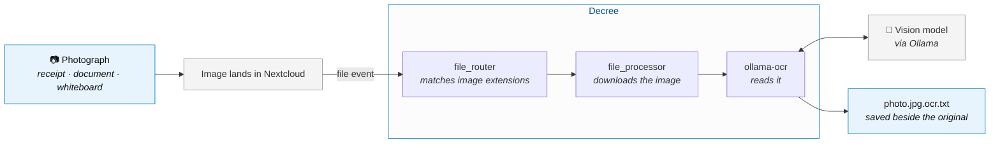

# Camera → OCR

Photograph a receipt, a document, a whiteboard, a page of handwriting — and get its text
back, filed next to the image, without opening anything.

The flow is **image lands in storage → text comes out beside it.** How the photo gets into
storage is a detail you choose; the OCR half is the same either way.



The text lands as a sibling file, so the image and its contents stay together and both get
picked up by whatever indexes that folder next:

```
receipts/2026-08-14_grocery.jpg
receipts/2026-08-14_grocery.jpg.ocr.txt   ← created automatically
```

## Getting the photo in

Anything that uploads to Nextcloud triggers the flow. Pick whichever you'll actually
use — the OCR pipeline does not care which one you chose, and you can run several at once.

| Route | Good for | Setup |
|---|---|---|
| **Nextcloud auto-upload** | The default. Your phone's camera roll syncs, and every photo is OCR'd. No bot, no token. | Turn on the Nextcloud mobile app's auto-upload |
| **A Telegram bot** | Deliberate capture — you choose what gets sent, rather than everything you photograph | [Option B](#option-b--telegram-bot) |
| **rclone / a script** | Scanners, batch imports, anything already on disk | `rclone copyto file.jpg nextcloud:scans/file.jpg` |
| **Any WebDAV client** | Other apps writing to Nextcloud directly | Nothing — the upload is the trigger |

:::tip[Start with auto-upload]
If you already run Nextcloud, camera auto-upload is the shortest path to this flow working:
photograph something, and the text exists a few seconds later. The Telegram route is
worth it when you want a *deliberate* inbox rather than your whole camera roll.
:::

## How It Works

### 1. The image lands in Nextcloud

However it got there — camera sync, a bot, rclone, another app — the flow starts the moment
the upload finishes. Nothing polls the image itself.

### 2. Nextcloud fires the webhook

The upload raises a `NodeWrittenEvent`, which Nextcloud POSTs to the Decree webhook's `/files` endpoint. This is the same pipeline used for any file uploaded to Nextcloud.

### 3. file_router matches image extensions

`file_router` scans the `ollama-ocr` processor and reads its pattern:

```bash
PATTERN='\.(jpg|jpeg|png|webp|gif|heic|heif|tiff?|bmp)$'
IS_PRE_SIGNED=false
```

A match enqueues a `file_processor` message with `is_pre_signed: false` — the file will be downloaded locally.

### 4. file_processor downloads the image

`file_processor` runs `rclone copyto` to pull the image into a temp path and exports it as `FILE_PATH`. No share link is involved — the full image bytes are needed to encode as base64 for the vision API.

### 5. ollama-ocr extracts the text

`ollama-ocr.sh` invokes `ocr.ts`, which:

1. Reads the image from `FILE_PATH` and encodes it as base64
2. POSTs to `http://ollama:11434/api/generate` with the configured vision model and an extraction prompt
3. Writes the returned text to stdout

The shell processor pipes that output via `rclone rcat` to Nextcloud at the same path with `.ocr.txt` appended:

```
telegram/1745000000_AgADjk.jpg
telegram/1745000000_AgADjk.jpg.ocr.txt   ← created automatically
```

## Prerequisites

- **Nextcloud** with file events on (the Nextcloud quest sets this up — see [File Processor](../decree/file-change-processing#setup))
- **Ollama** running with a vision-capable model pulled (e.g. `llava`, `llava-phi3`, `moondream`)
- **rclone** configured with a `nextcloud` remote

Nothing on that list is specific to how you take the picture.

## Setup

### Step 1 — Pull a vision model in Ollama

```bash
docker exec ollama ollama pull llava
```

Any Ollama-compatible vision model works. `llava` is a solid general-purpose choice; `llava-phi3` is faster on CPU.

### Step 2 — file events and rclone

The Nextcloud quest walks through this. Or follow [File Processor → Setup](../decree/file-change-processing#setup):
two migrations, one for the `nextcloud` rclone remote and one that registers the webhooks.

### Step 3 — Point a camera at it

That is the whole OCR pipeline. Now pick how images arrive.

#### Option A — Nextcloud camera auto-upload

In the Nextcloud mobile app, turn on **Auto upload**. Every photo you take syncs up and gets
OCR'd. There is nothing else to configure — the upload is the trigger.

#### Option B — Telegram bot

Use this when you want a deliberate inbox instead of your whole camera roll: you photograph
something and *choose* to send it.

Create the bot via [@BotFather](https://t.me/BotFather) with `/newbot` and copy the token, then:

```bash
mkdir -p automation/secrets/telegram
cat > automation/secrets/telegram/credentials.env << 'EOF'
TELEGRAM_BOT_TOKEN=your-token-here
EOF
```

The secrets directory is bind-mounted into the decree container at `/secrets/telegram/`.

Copy and activate the example cron:

```bash
cp automation-examples/cron/telegram-poll.md \
   automation/cron/
```

`telegram_ingest` polls `getUpdates` every minute, tracks a cursor in
`/secrets/telegram/offset.txt` so nothing is processed twice, and pipes each new photo through
`rclone rcat` into `TELEGRAM_RCLONE_DEST`. From there it is an ordinary Nextcloud upload and the
flow above takes over. The daemon rescans `cron/` every tick, so there is nothing to restart.

#### Option C — rclone

For scanners, batch imports, or anything already on disk:

```bash
rclone copyto /path/to/scan.jpg nextcloud:documents/scan.jpg \
  --config automation/secrets/rclone/rclone.conf
```

## Customization

| Variable | Default | Description |
|---|---|---|
| `TELEGRAM_RCLONE_DEST` | `nextcloud:telegram` | *Telegram route only* — where downloaded images are stored (triggers the OCR pipeline) |
| `FILE_SUFFIX` | `.ocr.txt` | Suffix appended to the image path for the OCR output |
| `OUTPUT_RCLONE` | `nextcloud` | rclone remote where the OCR result is saved |
| `OCR_MODEL` | `EXIST_MODEL_VISION` | Ollama vision model used for text extraction. Chosen globally in `.env.shared`, not per-flow. |
| `OLLAMA_URL` | `http://ollama:11434` | Ollama API base URL |

## Testing

Upload a test image straight into Nextcloud to bypass whichever capture route you chose and verify the OCR pipeline on its own — the upload fires the event itself:

```bash
rclone copyto /path/to/test.jpg nextcloud:telegram/test.jpg \
  --config automation/secrets/rclone/rclone.conf
```

Watch the run complete:

```bash
docker logs -f automation
docker exec automation decree status
docker exec automation decree log <id-prefix>
```

## Reusing the OCR function

`ocr.ts` is a standalone library importable in any other TypeScript script:

```typescript
import { ocr } from "/work/.decree/lib/ocr";

const text = await ocr("/tmp/some-file.png", {
  model: "llava-phi3",
  prompt: "What does this receipt total?",
});
```
