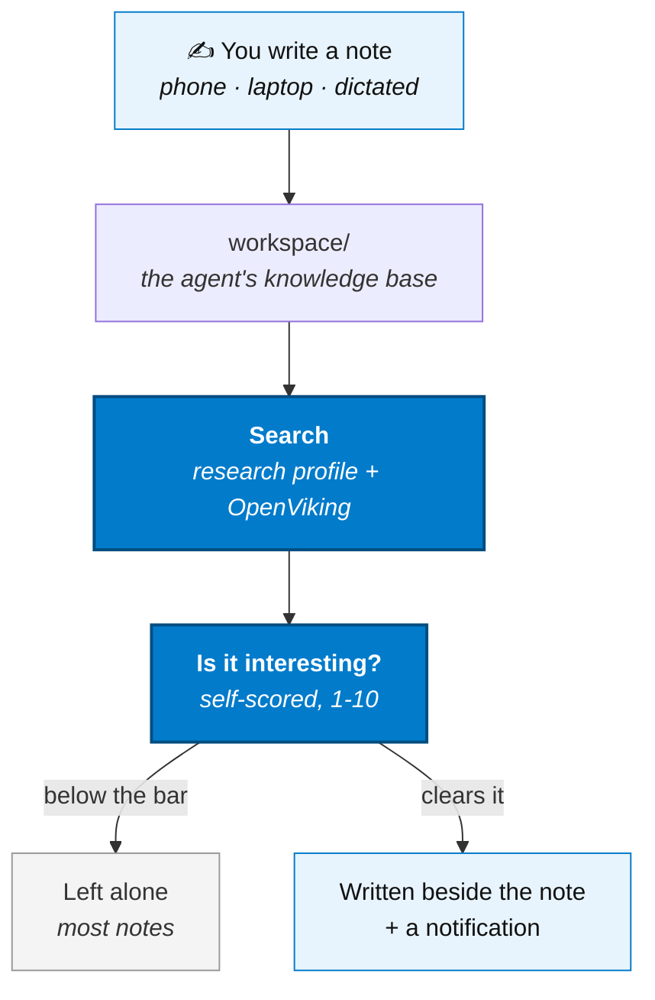

# Note → Connection

Each new or changed note is checked against everything else in `workspace/`. When it connects
to something you already wrote, you get the connection beside the note and a notification.



## How it differs from triage

- [Note → Action](./note-to-action) asks "is this worth acting on?"
- This asks, of every new note, "does something I already wrote connect to this?"
- A shared topic isn't enough. It has to tell you something you wouldn't get from remembering the
  earlier note.

## The two moves

### 1. Search

The note goes to a [Hermes](../ai/hermes) profile (`research` by default) that searches the
[OpenViking](../ai/openviking) index as an MCP tool.

### 2. Score

The same call returns `NONE`, or one connection with a 1-10 score. Only a score at or above
`CONNECT_MIN_SCORE` (7) is written and sent. A pairing is never sent twice; editing the note can
surface a different one.

## Turning it on

- `./existential.sh flow on note-connect` turns on Hermes and the `knowledgebase` flow (which
  indexes `workspace/` into OpenViking) and copies `note-connect.md` into
  `volumes/workspace_data/.decree/cron/`.
- `NOTES_DIR` defaults to `/workspace`.
- Off: `./existential.sh flow off note-connect`.

### Pointing it at a different vault

To scan [Note → Action](./note-to-action)'s vault mirror instead, set `NOTES_DIR=/data/notes`
in `automation/.env`. It's an environment variable, so it applies to the other notes machines too.

### Check it before trusting it

```bash
echo | docker exec -i automation decree emit --machine note_connect --param CONNECT_DRY_RUN=true
```

A dry run logs every candidate and score and writes nothing, ledger included.

:::warning[The first run does nothing, on purpose]
It records the tree as seen without scanning, so a full `workspace/` doesn't fire a call per
file. To scan the backlog once:

```bash
echo | docker exec -i automation decree emit --machine note_connect --param CONNECT_BOOTSTRAP=true
```
:::

### Prerequisites

- `workspace/` indexed by [OpenViking](../ai/openviking) (the `knowledgebase` flow).
- [Hermes](../ai/hermes) with the `research` profile, provisioned on boot. Restart `hermes-agent`
  if you enabled Hermes before OpenViking.

## Settings reference

| Setting | Default | Does |
|---|---|---|
| `CONNECT_MIN_SCORE` | `7` | How interesting a connection has to be, 1-10 |
| `CONNECT_PROFILE` | `research` | Which hermes profile searches — needs `mcp: openviking` |
| `CONNECT_DRY_RUN` | `false` | Log every candidate and score, write nothing, notify no one |
| `CONNECT_LEDGER` | `true` | The same source-to-target pairing is never surfaced twice |
| `CONNECT_MAX_NOTES` | `20` | Ceiling per run |
| `CONNECT_MIN_CHARS` | `120` | Below this a note is skipped without a model call |
| `CONNECT_MAX_CHARS` | `6000` | Note text is truncated to this many characters before searching |
| `CONNECT_MODEL` | *(profile default)* | Pin a specific model |
| `CONNECT_TIMEOUT` | `300` | Seconds for the department call before it's treated as no answer |
| `CONNECT_API_KEY` | *(falls back to `HERMES_API_KEY`)* | Override the gateway credential |
| `CONNECT_NOTIFY` | `true` | Send an ntfy notification when a connection is surfaced |
| `CONNECT_OUTPUT_RCLONE_DEST` | *(unset)* | Where the writeup is copied, e.g. `nextcloud:Notes` |

All of these are cron frontmatter.

:::warning[Don't point the output back into NOTES_DIR]
Output goes to `/data/note-connect/output`, outside `NOTES_DIR`, or the next run would treat it
as a new note. Point `CONNECT_OUTPUT_RCLONE_DEST` at a vault folder, not `workspace/` or
`/data/notes` (an rclone sync cache that deletes what's written to it).
:::

## What ships and what you write

| Part | Status |
|---|---|
| Vault diff — detecting new and changed notes | **Ships.** Hashes the vault and diffs against the last run, same mechanism as Note → Action |
| Searching the knowledge base | **Ships.** The `research` hermes profile, with OpenViking as an MCP tool |
| Scoring and the relevance gate | **Ships.** One self-scored call; only scores at or above `CONNECT_MIN_SCORE` surface |
| Not repeating the same pairing | **Ships.** A plain ledger at `/data/note-connect/connections.tsv` |
| Writing the result beside the note | **Ships.** `<note>.connection.md`, copied over rclone when configured |
| Notifying you | **Ships.** `notify` → ntfy |
| **How interesting is interesting enough** | **Yours.** `CONNECT_MIN_SCORE` |
