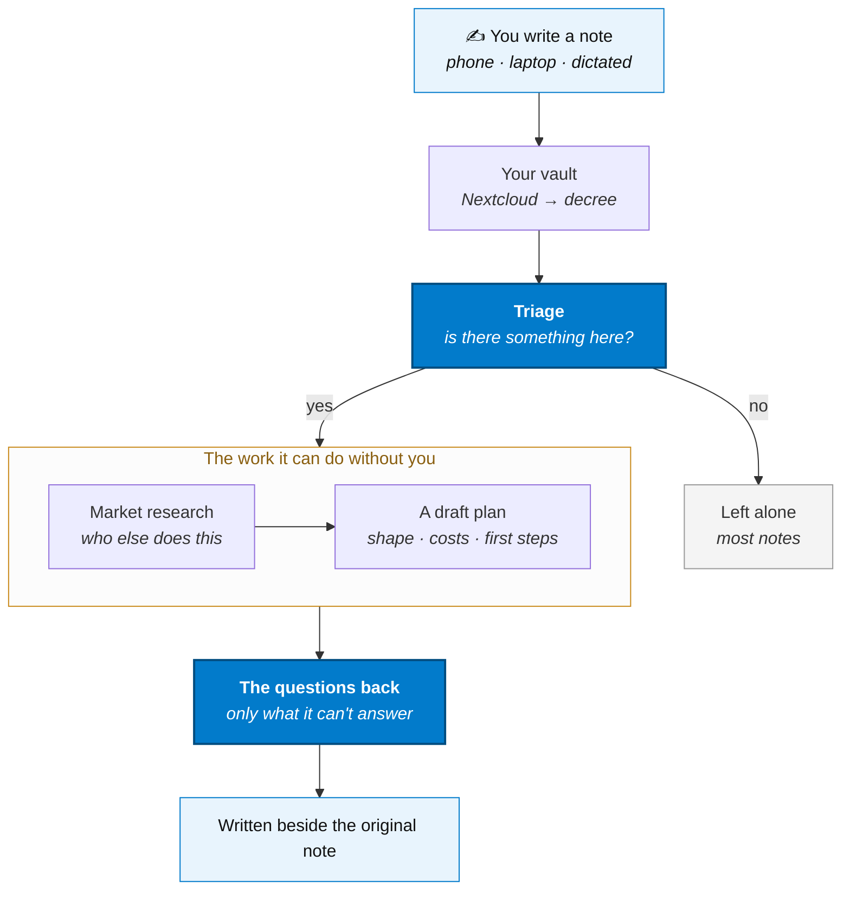

# Note → Action

Each new note is checked for something worth acting on. If there is, the work that needs no
input from you gets done, and you get back the questions only you can answer.

The example here is **a business idea**. Any kind of note works the same way.



## The four moves

### 1. Notes arrive

You write as usual; it syncs to Nextcloud. The `notes` machine pulls the vault and compiles it
into per-directory markdown with an index.

### 2. Triage — is there anything here?

`note_triage` asks one cheap question per note: **is there a real idea in this?**

- Only new and changed notes: the vault is hashed each run and diffed against the last.
- Keep it strict. A triage that passes everything produces a folder of unread reports.

### 3. Do what can be done unattended

For notes that pass, follow-up work is chained, each step its own message:

- **Market research**: who does this, what they charge, where the gap is.
  [Firecrawl](../ai/firecrawl) reads the pages.
- **A draft plan**: shape, rough costs, what must be true, first three steps.
- **Your own notes**: anything else in your vault that bears on it.

### 4. Come back with the right questions

The output ends with **the two or three questions whose answers change the conclusion**:

> *Does the licensing apply to resale? Is this a weekend project or the thing you leave your job
> for? The plan branches on that.*

They're written beside the original note. Answer them and the next run picks up from there.

## The four machines

| Machine | Does | Swap it when |
|---|---|---|
| `notes` | Pulls the vault from Nextcloud into `/data/notes` | Your notes live elsewhere |
| `note_triage` | Diffs the vault, judges each new note, checks the ledger, chains the next step | Never |
| `note_develop` | *(default)* Researches and drafts one document | You want the fan-out |
| `idea_workup` | *(alternative)* Sends the idea to three hermes departments | You want one document |

## Setting it up, step by step

### 1. Turn it on

```bash
./existential.sh flow on note-triage
```

This copies `note-triage.md` into `volumes/workspace_data/.decree/cron/`. Its `TRIAGE_ROUTINE`
param picks `note_develop` (default) or `idea_workup`.

### 2. Confirm the hermes profiles exist — fan-out path only

```bash
docker exec hermes-agent ls /opt/data/profiles
```

`research` and `sales` are provisioned on boot from `ai/hermes/profiles/`. If missing,
`docker compose up -d hermes-agent`. Each is served at `/p/<name>/v1` with its own API key; an
unprovisioned one returns 401.

### 3. Watch it do nothing

:::warning[The first run does nothing, on purpose]
It records your vault as seen without triaging, so a 5,000-note vault doesn't fire 5,000 model
calls. To scan the backlog once:

```bash
echo | docker exec -i automation decree emit --machine note_triage --param TRIAGE_BOOTSTRAP=true
```
:::

### 4. Check it before trusting it

```bash
echo | docker exec -i automation decree emit --machine note_triage --param TRIAGE_DRY_RUN=true
```

A dry run prints a verdict per note, chains nothing and writes no ledger entries.

### Prerequisites

- Notes in `/data/notes`: turn on `notes-to-dropbox`, or point `NOTES_DIR` at a vault you sync.
- A chat model (`EXIST_MODEL_URL_CHAT` or `EXIST_MODEL_URL`). [Hermes](../ai/hermes) is needed only
  for the departments.

## Swap the judgment

`TRIAGE_CRITERIA` in the cron file decides what the flow is for:

```yaml
TRIAGE_CRITERIA: "a business idea — something the author could plausibly build, sell, or start"
```

If it fires too often, make it narrower: "a product someone would pay for that I could build a
first version of in a month".

## Is it new? The idea ledger

`/data/note-triage/ideas.tsv` lists every idea already processed. A passing note gets one more
call: is it the same as one on the list? Duplicates stop there.

```
2026-08-14T09:11:04Z	A tool-rental service for the neighborhood, booked from a phone
2026-08-22T17:40:55Z	A newsletter that summarizes local council minutes
```

Edit it freely; delete a line to let an idea through again.

| Param | Default | Does |
|---|---|---|
| `TRIAGE_LEDGER` | `true` | `false` chains every pass, duplicates included |
| `TRIAGE_LEDGER_MAX` | `100` | Past ideas checked, most recent first |

On an error or unclear answer the idea counts as new.

## Swap the work

`TRIAGE_ROUTINE` names what runs on a pass.

### `note_develop` — one document

The default. One file: what the idea is, what can be worked out, and two to four questions for
you. Needs only a chat model. Output goes to `/data/note-triage/output`, and beside the note when
`NOTE_OUTPUT_RCLONE_DEST` is set.

### `idea_workup` — three departments, three answers

```yaml
TRIAGE_ROUTINE: idea_workup
```

It emits three messages, each to the hermes profile with the right tools:

| Question | Department | Why |
|---|---|---|
| Who else is doing this? | `research` | Web access, Firecrawl, OpenViking |
| How big is the market? | `research` | Same tools, separate document |
| What is my value proposition? | `sales` | Pricing and positioning |

Each answer is its own file in `workspace/ai/`, with its own notification:

```
workspace/ai/tool-rental-competition.md
workspace/ai/tool-rental-tam.md
workspace/ai/tool-rental-value-prop.md
```

:::info[Why three messages]
The default hermes profile carries every tool, about 40,000 prompt tokens a call. A narrow
profile costs a fraction, and each question retries and logs on its own. See
[Routing to Departments](../decree/routing).
:::

### Writing a third one

Write a machine, add it to `TRIAGE_ROUTINE`'s `enum` and the `emits:` list in
`automation/machines/note_triage.yml`, and name it in the cron file. It receives `note_path` and
`note_reason`. See [Writing an Automation](../writing-a-routine).

## Swap the input

Triage takes text and a name, so any input works. Only the first step changes.

```
<anything> ──▶ message ──▶ note_triage ──▶ ledger ──▶ idea_workup ──▶ departments
```

### Email

`gmail_sync` archives mail into `automation/emails/` (`/work/.decree/emails` in the container).
Point `NOTES_DIR` there and set the criteria to what you want caught. See
[Gmail](../integrations/gmail).

### A file you dropped somewhere

- In the workspace: a [file handler](../decree/file-handlers) line in `.decree/handlers.yml`.
- Through Nextcloud: a file event reaches `file_router`, which matches a **file processor** by
  path and optional content gate:

```bash
PATTERN="^nextcloud:workspace/.*\.md$"
CRITERIA="a business idea"
```

See [File Change Processing](../decree/file-change-processing).

### A sensor, or something you said out loud

A Home Assistant automation POSTs the decree webhook. See [HAwake](./hawake-homeassistant).

## Cost and pacing

- Decree runs one message at a time, and a department call can take up to 900 seconds
  (`agent_task`'s `agent_timeout`). A three-question fan-out can take most of an hour. Watch it in
  `volumes/workspace_data/.decree/runs/` or Grafana's **Decree Overview**.
- Triage is two short calls per note, only for new or changed notes over `TRIAGE_MIN_CHARS`.
  `TRIAGE_MAX_NOTES` caps a run.

## Settings reference

Cron file `params:`:

| Setting | Default | Does |
|---|---|---|
| `TRIAGE_CRITERIA` | *a business idea* | What counts as worth acting on |
| `TRIAGE_ROUTINE` | `note_develop` | What runs on a pass: `idea_workup`, or your own |
| `TRIAGE_DRY_RUN` | `false` | Log verdicts, chain nothing, write no ledger |
| `TRIAGE_LEDGER` | `true` | The "is this idea new?" check |
| `TRIAGE_MAX_NOTES` | `20` | Ceiling per run |
| `TRIAGE_BOOTSTRAP` | `false` | One run that scans the existing vault |

Environment, in `automation/.env`:

| Variable | Default | Does |
|---|---|---|
| `TRIAGE_LEDGER_MAX` | `100` | Past ideas the ledger check sees |
| `TRIAGE_MIN_CHARS` | `120` | Shorter notes are skipped without a model call |
| `TRIAGE_MAX_CHARS` | `6000` | Note text is cut to this before judging |
| `MODEL_TIMEOUT` | `120` (`300` in `note_develop`) | Seconds per model call |
| `NOTE_OUTPUT_RCLONE_DEST` | *(unset)* | Where `note_develop`'s draft is copied, e.g. `nextcloud:Notes` |

:::warning[Don't point the output at your vault cache]
`/data/notes` is an rclone sync cache, so anything written there is deleted. Drafts go to
`/data/note-triage/output` and are copied back over rclone.
:::

## What ships and what you write

| Part | Status |
|---|---|
| Vault sync and compilation | **Ships.** `notes` |
| Detecting new and changed notes | **Ships.** `note_triage` |
| The triage call and the chain | **Ships.** `note_triage` → `decree emit` |
| Knowing an idea was already evaluated | **Ships.** `/data/note-triage/ideas.tsv` |
| Research, draft, open questions | **Ships.** `note_develop`, with [Firecrawl](../ai/firecrawl) when enabled |
| Competition, market size, value proposition | **Ships.** `idea_workup` → `agent_task` |
| Indexing notes | **Ships.** `workspace/` into [OpenViking](../ai/openviking) every 15 minutes |
| Notifying you | **Ships.** `notify` → ntfy |
| **What counts as worth acting on** | **Yours.** `TRIAGE_CRITERIA` |
