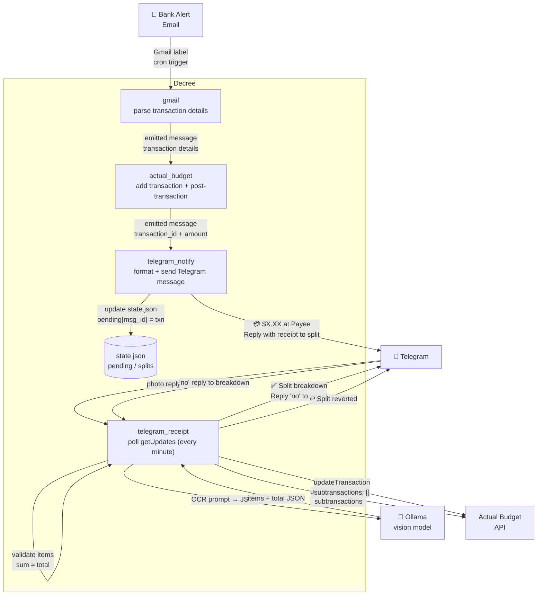

# Bank Alert → Receipt Split

A full end-to-end flow: a bank alert email arrives in Gmail, the transaction is parsed and saved to Actual Budget, a Telegram notification fires, and if you reply with a receipt photo the transaction is automatically split into line items — all without leaving Telegram.



## How It Works

### 1. Bank alert arrives in Gmail

A bank sends a transaction alert email. `gmail_sync` picks it up through a Gmail label filter and emits a message with the transaction fields parsed from the email body.

### 2. Transaction saved to Actual Budget

`actual_budget` calls `post-transaction.ts` to create the transaction, then captures its assigned UUID. If `/secrets/telegram/credentials.env` is present, it immediately emits a `telegram_notify` message for the sidecar flow.

### 3. Telegram notification sent

`telegram_notify` formats and sends a message to your configured chat:

```
💳 -$47.23 at Whole Foods Market on 2026-04-22

Reply with a receipt photo to split this transaction.
```

The message ID is stored in `state.json` under `pending[msg_id]` so the receipt handler can match photo replies to the right transaction.

### 4. Receipt photo triggers OCR

`telegram_receipt` polls `getUpdates` every minute. When it detects a photo:

- **Reply to the notification** — matched to that specific transaction via `reply_to_message_id`
- **Any other photo** — matched to the most recently sent notification (`last_pending_message_id`)

The photo is downloaded from Telegram, then OCR'd by `ocr.ts` using the Ollama vision model with a structured prompt:

```
Analyze this receipt and return ONLY a JSON object — no explanation, no markdown fences.
Format: {"items":[{"name":"string","amount":0.00}],"total":0.00}
Include every line item. Use negative amounts for discounts. "total" must match the receipt grand total.
```

### 5. Validation

Before splitting, the script verifies the OCR output:

- JSON must have `items` and `total`
- Sum of all item amounts must match `total` within 2 cents (rounding tolerance)

If validation fails, the user gets an error message and can retry with a clearer photo.

### 6. Transaction split

`split-transaction.ts` calls the Actual Budget API:

```typescript
await api.updateTransaction(transactionId, {
  subtransactions: splits.map((s) => ({ amount: s.amount_cents, notes: s.name })),
});
```

A breakdown is sent back to Telegram:

```
✅ Split into 4 items:
• Organic Milk: $4.99
• Sourdough Bread: $5.49
• Chicken Thighs: $12.30
• Produce: $24.45
Total: $47.23 ✓

Reply no to revert.
```

### 7. Reverting a split

Replying `no` (case-insensitive) to the breakdown message calls `revert-split.ts`:

```typescript
await api.updateTransaction(transactionId, { subtransactions: [] });
```

The transaction is restored as a single entry and Telegram confirms the revert.

## Prerequisites

- **Existing bank alert flow** set up and working (see [Bank Alert → Actual Budget](./transaction-gmail-actual-budget))
- **Actual Budget** running and accessible
- **Telegram bot** created and credentials configured (see [Telegram integration](../integrations/telegram))
- **Ollama** running with a vision-capable model (e.g. `llava`) loaded

## Setup

### Step 1 — Configure Telegram

Follow the [Telegram integration guide](../integrations/telegram) to:

1. Create a bot with @BotFather
2. Get your chat ID
3. Save credentials to `automation/secrets/telegram/credentials.env` (mounted into the
   container at `/secrets/telegram/credentials.env`)

### Step 2 — Activate the receipt polling cron

```bash
cp automation-examples/cron/telegram-receipt-poll.md \
   volumes/workspace_data/.decree/cron/
```

This schedules `telegram_receipt` to run every minute. The daemon rescans `cron/` every tick, so
there is nothing to restart.

### Step 3 — Verify

Send a test notification by hand:

```bash
echo | docker exec -i automation decree emit --machine telegram_notify \
  --param transaction_id=test-123 --param amount_cents=-4723 \
  --param payee_name="Whole Foods Market" --param date=2026-04-22
```

## Customization

| Variable | Default | Description |
|---|---|---|
| `TELEGRAM_RCLONE_DEST` | `nextcloud:telegram` | Where non-receipt photos are saved (generic uploads) |
| `OCR_MODEL` | `EXIST_MODEL_VISION` | Vision model used for receipt OCR. Chosen globally in `.env.shared`, not per-flow. |
| `EXIST_MODEL_URL_VISION` | *(blank → `EXIST_MODEL_URL`)* | OpenAI-compatible `/v1` URL serving the vision model. Set in `.env.shared`. |

## State File

All pending notifications and active splits are tracked in `/secrets/telegram/state.json`
inside the container — `automation/secrets/telegram/state.json` on the host. Inspect it at any
time:

```bash
cat automation/secrets/telegram/state.json | jq .
```

To reset state (e.g. after testing):

```bash
echo '{"pending":{},"splits":{},"last_pending_message_id":null}' \
  > automation/secrets/telegram/state.json
```
