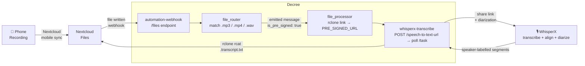

# Recording → Transcription

Automatically transcribe any audio or video recording dropped into Nextcloud. The moment a file lands in Nextcloud, Decree generates a share link, hands it to WhisperX, and saves a **speaker-labelled** transcript next to the original file — no manual steps, no intermediate storage.



## How It Works

### 1. Phone uploads the recording

The Nextcloud mobile app auto-syncs your phone's recordings folder to Nextcloud. Any `.mp3`, `.mp4`, or `.wav` file uploaded this way is an ordinary Nextcloud upload.

### 2. Nextcloud fires the webhook

The upload raises a `NodeWrittenEvent`, which Nextcloud POSTs to the Decree webhook's `/files` endpoint. `rclone_src` in the webhook config tells `file_router` which rclone remote the path belongs to in all subsequent steps.

### 3. file_router matches the file

`file_router` scans every processor script in `automation/lib/file-processors/` for a `PATTERN=` match against the full rclone path. The `whisperx-transcribe` processor declares:

```bash
PATTERN='\.[Mm][Pp][34]$|\.[Ww][Aa][Vv]$'
IS_PRE_SIGNED=true
```

It matches `.mp3`, `.mp4`, and `.wav` case-insensitively. Because `IS_PRE_SIGNED=true`, the emitted message carries `is_pre_signed: true` — telling `file_processor` not to download the file.

### 4. file_processor generates a share link

Instead of downloading the file, `file_processor` calls `rclone link` to generate a share link for the audio file and exports it as `PRE_SIGNED_URL`. No audio data touches the Decree container's disk.

### 5. whisperx-transcribe submits to WhisperX

`whisperx-transcribe.sh` invokes `whisperx-transcribe.ts`, which:

1. POSTs the `PRE_SIGNED_URL` to `http://whisperx:8000/speech-to-text-url` — WhisperX fetches the audio itself and runs the full transcribe → align → diarize pipeline
2. Polls `GET /task/{id}` until the task reports `completed` (diarized runs take longer than plain transcription)
3. Collapses the result's speaker-tagged segments into `[SPEAKER_00] …` lines
4. Writes the speaker-labelled transcript to stdout

### 6. Transcript saved next to the original

The bash processor pipes the transcription text through `rclone rcat` directly into Nextcloud at the same path as the audio file, with `.transcript.txt` appended:

```
recordings/2026-04-22 Meeting.mp3
recordings/2026-04-22 Meeting.mp3.transcript.txt   ← created automatically
```

## Prerequisites

- **Nextcloud** running, with file events on (see [File Processor](../decree/file-change-processing#setup) — Core does it)
- **WhisperX** container running and reachable at `http://whisperx:8000`
- **rclone** configured with a `nextcloud` remote (or whichever remote matches your `rclone_src` webhook setting)
- **Nextcloud mobile app** with auto-upload enabled for your recordings folder

## Setup

### Step 1 — file events

Core already did this. By hand, follow [File Processor → Setup](../decree/file-change-processing#setup):
two migrations, one for the `nextcloud` rclone remote and one that registers the webhooks.

### Step 2 — Enable WhisperX

Start the WhisperX container if it isn't already running (all compose commands run from the
repo root against the generated `docker-compose.yml` — never `-f` into a service's own
directory):

```bash
docker compose up -d whisperx
```

WhisperX will download the default model on first use. No further configuration is required — the `whisperx-transcribe` processor defaults to letting WhisperX pick its own model.

### Step 3 — Confirm the processor is active

The `whisperx-transcribe` processor is auto-discovered from `automation/lib/file-processors/`. No registration step is needed. After the first upload, its run shows up in:

```bash
docker exec automation decree status
```

### Step 4 — Configure Nextcloud mobile auto-upload

In the Nextcloud mobile app, enable auto-upload for your phone's voice recordings or screen recordings folder. Each upload fires the webhook, and the transcription flow triggers automatically.

## Customization

Override any of these in the processor script or pass them as frontmatter params:

| Variable | Default | Description |
|---|---|---|
| `FILE_SUFFIX` | `.transcript.txt` | Suffix appended to the audio file path for the output |
| `OUTPUT_RCLONE` | `nextcloud` | rclone remote where the transcript is saved |
| `WHISPERX_MODEL` | *(empty — WhisperX default)* | Model name passed to the transcription API |
| `WHISPERX_MIN_SPEAKERS` | *(empty — auto-detect)* | Lower bound on diarized speaker count |
| `WHISPERX_MAX_SPEAKERS` | *(empty — auto-detect)* | Upper bound on diarized speaker count |
| `WHISPERX_URL` | `http://whisperx:8000` | WhisperX API base URL |

## Testing

Send a synthetic file event to trigger the flow end-to-end:

```bash
# automation-webhook publishes no host port — it is reached over the exist
# bridge, so send the event from a container already on it.
docker exec automation curl -X POST http://automation-webhook:8801/files \
  -H "Authorization: Bearer <EXIST_DECREE_FILES_WEBHOOK_AUTH_TOKEN from .env.shared>" \
  -H "Content-Type: application/json" \
  -d '{"event":{"node":{"path":"/admin/files/recordings/test.mp3"},"class":"OCP\\Files\\Events\\Node\\NodeWrittenEvent"}}'
```

Watch processing in real time:

```bash
docker logs -f automation
```

Inspect the completed run:

```bash
docker exec automation decree status
docker exec automation decree log <id-prefix>
```
