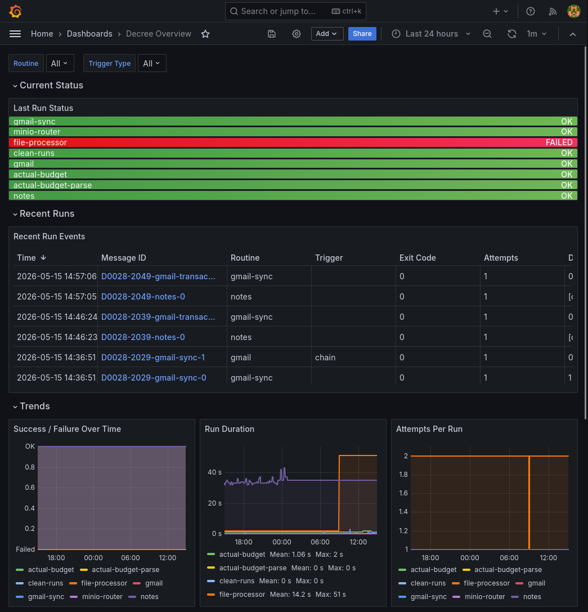

# Grafana

- Source: https://github.com/grafana/grafana
- License: [AGPL 3.0](https://www.gnu.org/licenses/agpl-3.0.html)
- UI: `https://grafana.<domain>`
- Credentials: `EXIST_USERNAME` / `EXIST_PASSWORD` (set via `.env.shared`)

Visualization layer for [Prometheus](./prometheus) metrics and [Loki](./loki) logs. Everything is provisioned from code — no manual setup needed.



## What's provisioned

| Resource | File | Purpose |
|---|---|---|
| Prometheus datasource | `provisioning/datasources/prometheus.yaml` | Default datasource, 15s scrape interval |
| Loki datasource | `provisioning/datasources/loki.yaml` | Log queries, max 1000 lines |
| Decree Overview dashboard | `provisioning/dashboards/decree-overview.json` | Pre-built Decree monitoring |
| Decree Run Detail dashboard | `provisioning/dashboards/decree-run-detail.json` | One run's `events.jsonl` and script output, by run ID |
| decree alert | `provisioning/alerting/decree.yaml` | A failed `automation-backup` run → one ntfy notification |

Grafana re-reads the dashboards directory every 30 seconds, so a dashboard JSON edit lands without a restart. Datasource provisioning is applied at startup only — restart grafana after editing a datasource YAML.

## Decree Overview dashboard

Covers both decree daemons, filterable by `daemon` and `machine`, with panels for:

- **Runs in range** — finished runs per machine, done and failed (Prometheus)
- **Run duration** — p95 per machine (Prometheus histogram)
- **Finished runs per hour** — stacked by final state
- **Recent runs** — one row per run (Loki, the `run_finished` events): machine, final state,
  duration, trigger, and the run ID, linking to the Run Detail dashboard

This is the main place to check when a Decree automation fails or behaves unexpectedly.

## Extending

- **New dashboard**: drop a JSON export into `hosting/grafana/provisioning/dashboards/`. Grafana auto-loads it.
- **New datasource**: add a YAML file to `hosting/grafana/provisioning/datasources/`.
- **Alerts**: unified alerting. `provisioning/alerting/decree.yaml` provisions the ntfy contact
  point (a webhook, authenticated as `EXIST_NTFY_USER`) and the `decree run failed` rule, on
  `increase(decree_runs_total{daemon="automation-backup",state="failed"}[10m]) > 0`, repeating at
  most every 6 hours per machine. The `automation` daemon reports its own runs without Grafana
  ([When a run needs you](../decree/decree.md#when-a-run-needs-you)), so it is left out. Rules made in
  the UI persist in the `grafana_data` volume.

## Data flow summary

```
<project>/runs/<id>/events.jsonl, <NNNN>-<state>-<script>.log
  └─ Alloy
       ├─ Loki (every event and every script's output)
       └─ /metrics → Prometheus (decree_runs_total, decree_run_duration_milliseconds)

Grafana
  ├─ queries Prometheus for metric panels
  └─ queries Loki for log panels
```
