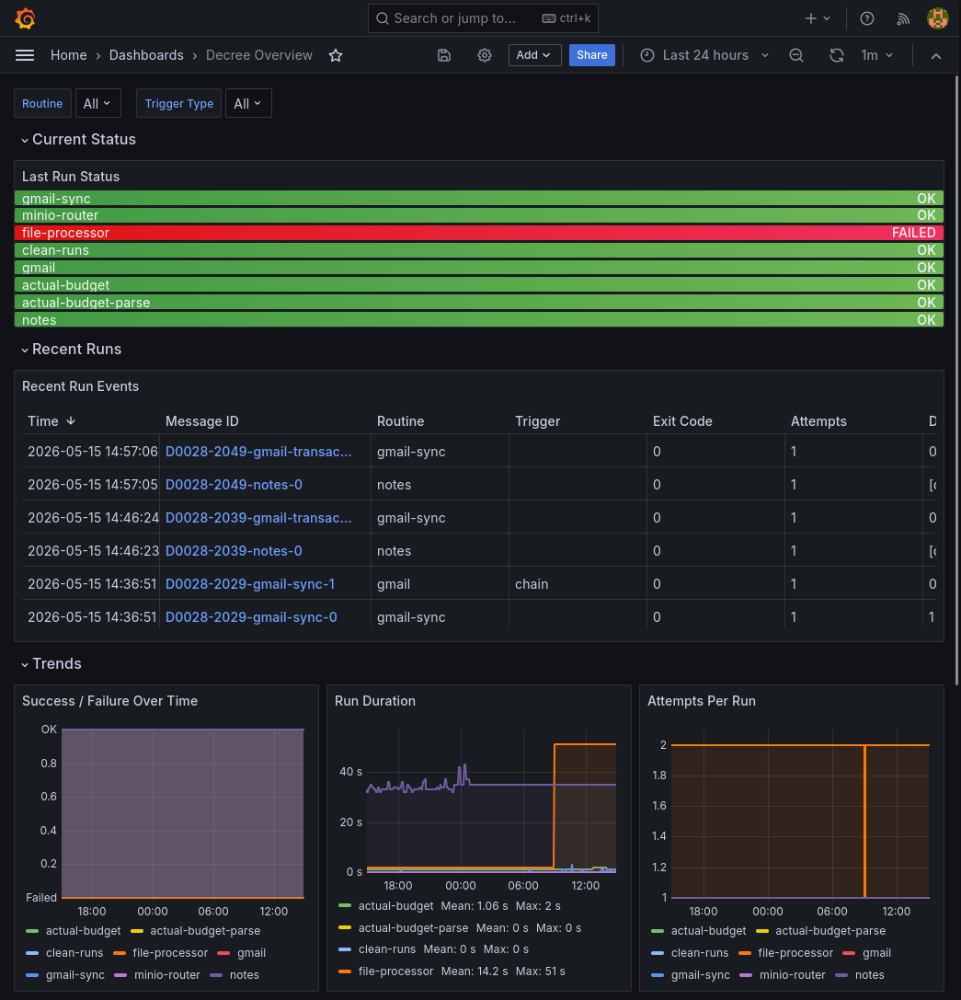

# Grafana

- Source: https://github.com/grafana/grafana
- License: [AGPL 3.0](https://www.gnu.org/licenses/agpl-3.0.html)
- UI: `https://grafana.<domain>`
- Credentials: `EXIST_USERNAME` / `EXIST_PASSWORD` (set via `.env.shared`)

Dashboards for [Prometheus](./prometheus.md) metrics and [Loki](./loki.md) logs, provisioned from code.



## What's provisioned

| Resource | File | Purpose |
|---|---|---|
| Prometheus datasource | `provisioning/datasources/prometheus.yaml` | Default datasource, 15s scrape interval |
| Loki datasource | `provisioning/datasources/loki.yaml` | Log queries, max 1000 lines |
| Decree Overview dashboard | `provisioning/dashboards/decree-overview.json` | Every decree run on every host that reports |
| Decree Run Detail dashboard | `provisioning/dashboards/decree-run-detail.json` | One run's `events.jsonl` and script output, by run ID |
| Hosts dashboard | `provisioning/dashboards/hosts.json` | Every host that reports: free disk space, CPU, RAM and VRAM, containers running, plugins and crons per project ([Controller and Workers](./controller-and-workers.md)) |
| Notifications dashboard | `provisioning/dashboards/notifications.json` | Every notification the stack sent to ntfy: which topics, and what each said |
| decree alerts | `provisioning/alerting/decree.yaml` | A failed run in `automation-backup` or a host's own project, a backup with no `done` run in 48h, or a container that stopped running on a host → one ntfy notification |

Grafana re-reads the dashboards directory every 30 seconds, so a dashboard JSON edit lands without a restart. Datasource provisioning is applied at startup only — restart grafana after editing a datasource YAML.

## Decree Overview dashboard

Every decree run on every host that reports, in each of existential's projects (`automation`,
`automation-backup`, `host`), filterable by `host`, `project` and `machine`. Each host's alloy
ships its runs live ([Loki](./loki.md)), so a run is here seconds after it ends:

- **Not 'done' runs** — every run that ended in anything but `done`: host, project, machine,
  state, duration, trigger, and the run ID, which opens it in Run Detail
- **Runs per machine** — done and not done, in the dashboard's range
- **Run duration** — p95 per machine
- **Recent runs** — every run, the same columns, each linking to Run Detail
- **Installed machines** — what each host's projects have installed, from its last report

This is the main place to check when a Decree automation fails or behaves unexpectedly.

## Notifications dashboard

Every notification a decree run sent, on every host that reports, read from the reply ntfy
gives the `notify` machine, which each host's alloy ships with the rest of the run:

- **Topics** — each topic that got one, and how many: these are what to subscribe to in the
  ntfy app. Everything goes to `decree` unless a flow names another
- **Notifications per day**, by topic
- **Notifications** — each one's topic, title and text
- **Grafana's own alerts** — the decree and container alerts go from Grafana straight to the `decree`
  topic, not through a run, so they are listed from Grafana itself

A message something else publishes to ntfy (your own `curl`) is not here.

## Extending

- **New dashboard**: drop a JSON export into `hosting/grafana/provisioning/dashboards/`. Grafana auto-loads it.
- **New datasource**: add a YAML file to `hosting/grafana/provisioning/datasources/`.
- **Alerts**: unified alerting. `provisioning/alerting/decree.yaml` provisions the ntfy contact
  point (a webhook, authenticated as `EXIST_NTFY_USER`) and two rules on Loki, each repeating at
  most every 6 hours per machine: `decree run failed`, a run in `automation-backup` or a host's
  own project that ended `failed` in the last 10 minutes, and `backup has not run`, a
  `db_backup`, `volume_backup` or `sqlite_backup` that ran in the last 8 days but has not ended
  `done` in 48 hours. The `automation` daemon reports its own runs without Grafana
  ([When a run needs you](../decree/decree.md#when-a-run-needs-you)), so it is left out. Rules made in
  the UI persist in the `grafana_data` volume.

## Data flow summary

```
each host: <project>/runs/<id>/events.jsonl, <NNNN>-<state>[-<script>].log
  └─ alloy (reporting-alloy, started by the reporting plugin)
       └─ Loki {job="decree"}, {job="decree_script"}, labelled host and project

each host: the reporting plugin, every 5 minutes
  └─ Loki {job="exist"}: disks, CPU/RAM/VRAM, installed machines and plugins, containers

Grafana
  ├─ queries Loki for Decree Overview, Run Detail, Hosts and the decree alerts
  └─ queries Prometheus for host and service metrics
```
