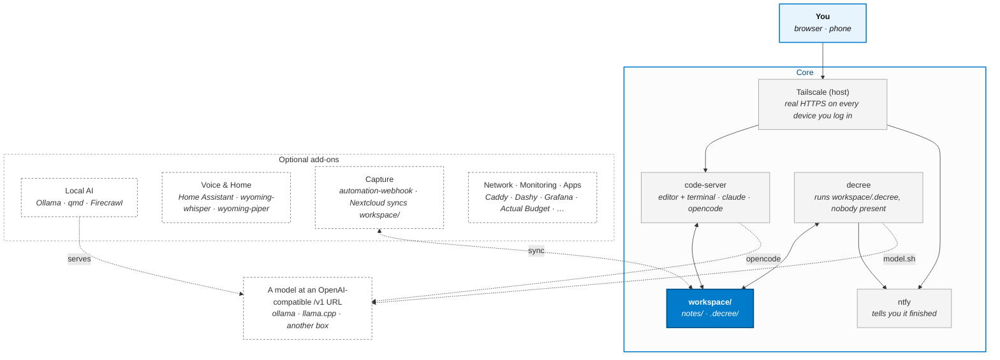

# Services

:::info[What runs]
The services that run, on which hosts, and how they fit together. Back to
[What It Is](./intro.md), or on to [Flows](./flows/index.md) to follow one job end to end.
:::

Each project named here fills a slot and can be swapped.

## The map



### In short

1. **One folder.** `workspace/` holds `notes/`, `.decree/` (your automations) and `.capture/`
   ([Capture](./getting-started.md#capture)). code-server opens it with `claude` and `opencode` in
   the terminal. [Nextcloud](./storage/nextcloud.md) can sync it to other devices.
2. **decree runs it.** Machines in `workspace/.decree/` run on a schedule, an inbox message or a
   webhook, and report through ntfy. Defaults include a daily
   [digest](./getting-started.md#you-were-here) and weekly and monthly
   [look backs](./getting-started.md#look-back). With Monitoring, run logs go to Loki.
3. **A model is a URL.** Everything that needs one uses an OpenAI-compatible `/v1` address:
   Ollama here, llama.cpp on [another box](./hosting/ai-box.md), anything that serves `/v1`.

## The AI, slot by slot

None of this is in Core. Each row is a flag; flows that need one turn it on.

| Slot | Ships as | What it does |
|---|---|---|
| **Models** | [Ollama](./ai/ollama.md), or any OpenAI-compatible server | Serves the models at `EXIST_MODEL_URL`. Each role can point elsewhere: [Configuration](./configuration.md#endpoints--putting-roles-on-different-hosts). |
| **Agent** | [pi](./ai/pi.md) | An agent with tools on the same model URL, in code-server's terminal and your automations. Baked in. |
| **Search** | [qmd](./ai/qmd.md) | Your notes, PDFs and Word files by meaning and exact words, for you and every agent. |
| **The web** | [Firecrawl](./ai/firecrawl.md) | Turns a URL into markdown a model can read. |
| **Speech → text (voice)** | [wyoming-whisper](./ai/wyoming-whisper.md) | What Home Assistant listens with. CPU only, so it never evicts a model from the GPU. |
| **Text → speech (voice)** | [wyoming-piper](./ai/wyoming-piper.md) | The voice Home Assistant answers in. CPU only. |
| **Voice front end** | [Home Assistant](./services/homeassistant.md) | Wake word, microphones, speakers, and control of the house. |
| **Speech → text (recordings)** | [WhisperX](./ai/whisperx.md) | Long recordings with speaker labels, on the GPU, run by decree. |
| **Text → speech (HTTP)** | [Chatterbox](./ai/chatterbox.md) | Cloneable voices over an OpenAI-compatible API. Nothing in the stack calls it yet. |
| **Chat front end** | [Open WebUI](./ai/open-web-ui.md) | Chat in a browser. |
| **Search** | [qmd](./ai/qmd.md) | Searches your notes, PDFs and Word files by words and by meaning, for you or for Claude in code-server. CPU only, no model needed. |

:::caution[pi doesn't edit the stack]
Change the stack with a coding agent on the host, against a frontier model. pi works on
`workspace/`.
:::

## How it's assembled

> **A true/false flag per service. Everything enabled is rendered, merged into one compose file
> and one env file, and run on one network.**

No plugin system, no registry, no orchestrator.

### 1. Choose — a flag per service

Every service is a folder, and every folder gets one flag in `.env.shared`:

```bash
EXIST_IS_<CATEGORY>_<SLUG>=true|false
```

The name comes from the path: `ai/firecrawl` → `EXIST_IS_AI_FIRECRAWL`. Categories are the
top-level folders: `ai/`, `services/`, `nas/`, `hosting/`. A disabled service writes nothing to
disk.

### 2. Render — templates become live files

`./existential.sh` renders every enabled service's `*.exist.*` templates, generating secrets
(`EXIST_32_CHAR_HEX_KEY` and others).

```
docker-compose.exist.yml   →  docker-compose.yml
.env.exist                 →  .env
config.exist.yml           →  config.yml
```

Templates are tracked in git; rendered files never are.

- **Each file renders once.** An existing file is left alone, so your answers and edits survive.
  `./existential.sh reset` archives rendered files to `archive/<timestamp>/` so the next run
  renders fresh.
- **New `.env` keys are appended** on every run, with their comments, and listed in the output.
  Existing values, blanks included, are never changed. That makes `git pull && ./existential.sh`
  an upgrade.
- **Files with nothing you could lose** (no secrets, no answers) are regenerated every run and
  say `DO NOT EDIT`: Dashy's `dashy-conf.yml`. Set `# EXIST_KEEP: true`
  in the header to keep yours.
- **Config inside a service's own datastore** (Home Assistant's proxy settings, Nextcloud's
  trusted domains, ntfy's user) is set by that service's `entrypoint.sh` on every start.

### 3. Merge — one compose file, one env file

Every enabled service's `docker-compose.yml` merges into one at the repo root, and every `.env`
into one root `.env`.

```bash
docker compose up -d     # always from the repo root, never from a service folder
```

The root compose file is regenerated every run. Edit the service's `docker-compose.exist.yml`
instead.

## Adding a service is adding a folder

Create `<category>/<slug>/docker-compose.exist.yml` and add its `EXIST_IS_*` flag. The folder
name is the container prefix, the flag and the hostname.

## One network

Everything joins one Docker network, `exist`, and reaches the rest by container name:

```
http://ollama:11434     http://firecrawl:3002     http://automation-webhook:8801
```

- Core's two web apps publish one port each, on loopback, for `tailscale serve`.
- Other services publish nothing; browsers reach them through Caddy at `https://<slug>.<domain>`.
- Containers talk plain HTTP by name.

## Core over Tailscale

code-server's previews and the ntfy phone app both need a certificate every device trusts.
Tailscale issues a Let's Encrypt certificate for the host's tailnet name, so
`./existential.sh` runs `tailscale serve`:

```
https://<host>.<tailnet>.ts.net       →  127.0.0.1:42080  (code-server)
https://<host>.<tailnet>.ts.net:8443  →  127.0.0.1:44680  (ntfy)
```

Nothing to install on devices, nothing on the LAN. Setup steps:
[Getting Started](./getting-started.md#setup).

## Hostnames that just work

For the Caddy add-on. `EXIST_DOMAIN` defaults to `<host-ip-with-dashes>.nip.io`, from this
host's LAN address:

```
EXIST_LOCAL_HOST_IP=192.168.1.20          (LAN address)
        ↓
EXIST_DOMAIN=192-168-1-20.nip.io   →  https://dashy.192-168-1-20.nip.io
```

- [nip.io](https://nip.io) is public wildcard DNS: `<anything>.<ip>.nip.io` resolves to that
  IP. No DNS setup, and a new service needs no DNS change.
- A LAN address only routes inside your network. Nothing is exposed. From elsewhere, use a
  [VPN](./hosting/vpn.md).
- With Tailscale up, the tailnet IP (`tailscale ip -4`) is used instead.

:::danger If you use Tailscale, don't use a MagicDNS name
`EXIST_DOMAIN=my-box.tailnet.ts.net` fails: MagicDNS has no wildcard under a node name, so
`dashy.my-box.tailnet.ts.net` doesn't resolve. Use the tailnet **IP** in nip.io form.
`tailscale serve` has the same limit, one hostname per node, which is why it serves only Core.
:::

Downsides of the default:

- The certificate is from the stack's own CA, so a browser warns until you
  [trust it on that device](./hosting/caddy.md#trust-its-ca-once-per-device).
  [A domain you own](#owned-domain-without-exposing-your-network) gets a certificate every
  device already trusts.
- Without internet, names stop resolving, even on the host. [pihole](./hosting/pihole.md)
  answers them locally.
- nip.io sees your host's IP and each service name you look up.

### Upgrading an existing install

Services read `EXIST_DOMAIN` at container start, so changing it applies on the next
`docker compose up -d`. An older install may still have baked values in its rendered `.env`
files. Delete these lines if present:

| File | Delete |
|---|---|
| `hosting/caddy/.env` | `CADDY_DOMAIN=` |
| `services/mealie/.env` | `MEALIE_BASE_URL=` |
| `nas/collabora/.env` | `COLLABORA_DOMAIN=`, `COLLABORA_NEXTCLOUD_DOMAIN=` |

- **A Caddyfile missing a newly enabled service's block:** copy the block from
  `Caddyfile.exist.Caddyfile`, or run `./existential.sh reset`.
- **`reset`** archives every rendered file plus decree's run logs and migration ledger, lists what
  it will move, and asks first. It never touches `_data` or `_backup` volumes; it offers to
  delete `_cache` ones.
- **`Permission denied`:** Docker created a missing bind-mount directory as root, usually from
  `docker compose up -d` in a tree that was never rendered. `./existential.sh run fix-permissions`
  (`--dry-run` first) gives them back to you without `sudo`.

## Owned domain without exposing your network

The default works with no setup, but its certificate comes from the stack's own CA, so a browser
warns until that CA is [trusted on the device](./hosting/caddy.md#trust-its-ca-once-per-device).
With a domain you own, every device trusts `https://<slug>.<domain>` with nothing to install.

Nothing on your network becomes reachable from outside. The DNS record points at a LAN address,
which only routes inside your network, and the certificate is issued by a DNS challenge:
Let's Encrypt reads a record from public DNS and never connects to you.

The steps use a subdomain, `home.example.com`, so the rest of the domain is untouched, and
Cloudflare as the DNS provider. [acme.sh](https://github.com/acmesh-official/acme.sh) issues
the certificate and [supports most other providers](https://github.com/acmesh-official/acme.sh/wiki/dnsapi).

### 1. One DNS record

At your DNS provider, add a wildcard `A` record at this host's LAN address
(`EXIST_LOCAL_HOST_IP` in `.env.shared`):

```
*.home.example.com   A   192.168.1.20
```

On Cloudflare, set it to **DNS only**, not proxied. A new service needs no further record.

### 2. A certificate

Make an API token that can edit the domain's DNS (Cloudflare: **My Profile → API Tokens →
Create Token → Edit zone DNS**, for that one zone). [Install acme.sh](https://github.com/acmesh-official/acme.sh#1-how-to-install),
then, from the repo:

```bash
acme.sh --set-default-ca --server letsencrypt
read -rs CF_Token && export CF_Token      # paste the token and press Enter; nothing is shown
acme.sh --issue --dns dns_cf -d '*.home.example.com' -d home.example.com
acme.sh --install-cert -d '*.home.example.com' \
  --fullchain-file "$PWD/hosting/caddy/certs/internal.pem" \
  --key-file       "$PWD/hosting/caddy/certs/internal-key.pem" \
  --reloadcmd      "docker restart caddy"
acme.sh --install-cronjob
```

Caddy serves whatever certificate is in those two files, and `./existential.sh` leaves one it
did not mint alone. The cron job renews it about every 60 days, copies it in and restarts Caddy.

### 3. Point the stack at it

```bash
EXIST_DOMAIN=home.example.com          # in .env.shared
./existential.sh && docker compose up -d
```

Every service now answers at `https://<slug>.home.example.com`. The old names stop working, so
update bookmarks and the ntfy app.

A name that doesn't resolve on your network is usually the router's DNS rebind protection, which
drops public answers that point at a private address. Allow the domain there, or answer it
locally with [pihole](./hosting/pihole.md).

## Core vs. complementary services

This is about the network, not about what ships on.

- **Core**: talks to other services by container name.
- **Complementary**: reached by a URL you could point anywhere, or by nothing. It can move to
  another host without changing anything else.

| Service | Why it's complementary |
|---|---|
| **NAS** (Nextcloud, Collabora) | Reached over rclone and HTTP, by URL. |
| **Immich** | Nothing in the stack talks to it. |
| **Home Assistant** | Nothing talks to it. It lives where your Zigbee/Z-Wave dongles are. |
| **pi-hole** | DNS for your whole network. No service calls it. |
| **Monitoring** (Grafana, Loki, Prometheus, Uptime-Kuma) | Nothing depends on it. |

## Recommended deployment

Even on one host, think of it as separate stacks, so moving one later is a config change.

```
┌─ NAS stack ──────────────┐   Storage and files.
│  Nextcloud, Collabora    │   Wants disks, not GPU.
│                          │   Reached over rclone / WebDAV URLs.
└──────────────────────────┘

┌─ Core stack ─────────────┐   The actual system.
│  code-server, decree,    │   Wants CPU and RAM, no GPU.
│  ntfy                    │   One network, container-name DNS.
└──────────────────────────┘

┌─ AI box ─────────────────┐   The models.
│  Ollama or llama.cpp,    │   Wants the GPU.
│  ComfyUI, …              │   Reached over an OpenAI-compatible /v1 URL.
└──────────────────────────┘

┌─ Standalone ─────────────┐   Independent appliances.
│  Immich      pi-hole     │   Own lifecycle, own host if you like.
│  Home Assistant          │   HA follows your USB radios.
└──────────────────────────┘
```

- **NAS:** storage wants disks and its own reboot schedule. Moving it is an endpoint change;
  `workspace/` [stays in sync](./getting-started.md#syncing-with-a-nas-or-a-nextcloud-optional).
- **Models:** restarting a model server shouldn't interrupt anything. The
  [AI box](./hosting/ai-box.md) is one URL in `.env.shared`.
- **pi-hole:** your LAN's DNS should stay up while you rebuild the stack.
- **Home Assistant:** it lives where your radios are, and your lights should keep working while
  you rebuild.

### Moving one to another host

1. Set that service's `EXIST_IS_*` flag to `false` on the original host and re-run
   `./existential.sh`.
2. Bring the service up on the new host.
3. Update the endpoint that pointed at it: the rclone remote, the model URL, or the DNS record.

### Watching every host

Once the stack spans hosts, each can report its free disk space and its decree machines' runs to
one Loki, for Grafana's **Hosts** dashboard: turn on the `worker` flow on each, with one of them
the controller the others ask where to report. See [Controller and Workers](./hosting/controller-and-workers.md).
