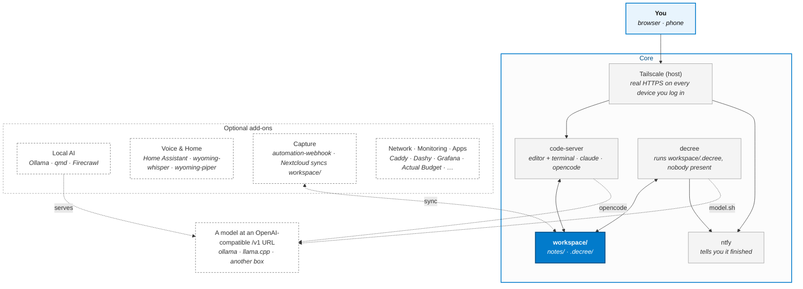

# How It's Built

The services that run, on which hosts, and how they are put together. What they do for a
person: [What It Does](./flows/index.md). Each project named here fills a slot and can be
swapped.

## The map



### In short

1. **One folder.** [`workspace/`](./workspace.md) holds `notes/`, `ai/` and `.decree/` (your
   automations). code-server opens it with `claude` and `opencode` in the terminal.
   [Nextcloud](./storage/nextcloud.md) can sync it to other devices.
2. **decree runs it.** Machines in `workspace/.decree/` run on a schedule, a file change, an
   inbox message or a webhook, and report through ntfy. Each is a [plugin](./plugins/index.md),
   off until turned on. With Monitoring, run logs go to Loki.
3. **A model is a URL.** Everything that needs one uses an OpenAI-compatible `/v1` address:
   Ollama here, llama.cpp on [another box](./hosting/ai-box.md), anything that serves `/v1`.

## The AI, slot by slot

Search, the web and pi are in Core; every other row is a flag.

| Slot | Ships as | What it does |
|---|---|---|
| **Models** | [Ollama](./ai/ollama.md), or any OpenAI-compatible server | Serves the models at `EXIST_MODEL_URL`, the one address everything uses: [Configuration](./configuration.md#endpoints--where-model-calls-go). |
| **Agent** | [pi](./ai/pi.md) | An agent with tools on the same model URL, in code-server's terminal and your automations. Baked in. |
| **Search** | [qmd](./ai/qmd.md) | Your notes, PDFs and Word files by meaning and exact words, for you and every agent. CPU only, no model needed. |
| **The web** | [Firecrawl](./ai/firecrawl.md) | Turns a URL into markdown a model can read. |
| **Speech → text (voice)** | [wyoming-whisper](./ai/wyoming-whisper.md) | What Home Assistant listens with. CPU only, so it never evicts a model from the GPU. |
| **Text → speech (voice)** | [wyoming-piper](./ai/wyoming-piper.md) | The voice Home Assistant answers in. CPU only. |
| **Voice front end** | [Home Assistant](./services/homeassistant.md) | Wake word, microphones, speakers, and control of the house. |
| **Speech → text (recordings)** | [WhisperX](./ai/whisperx.md) | Long recordings with speaker labels, on the GPU, run by decree. |
| **Text → speech (HTTP)** | [Chatterbox](./ai/chatterbox.md) | Cloneable voices over an OpenAI-compatible API. Nothing in the stack calls it yet. |
| **Chat front end** | [Open WebUI](./ai/open-web-ui.md) | Chat in a browser. |

:::caution[pi doesn't edit the stack]
Change the stack with a coding agent on the host, against a frontier model. pi works on
`workspace/`.
:::

## How it's assembled

> **A true/false flag per service. Everything enabled is rendered, merged into one compose file
> and one env file, and run on one network.**

No registry, no orchestrator: a service is a folder.

### 1. Choose — a flag per service

Every service is a folder, and every folder gets one flag in `.env.shared`:

```bash
EXIST_IS_<CATEGORY>_<SLUG>=true|false
```

The name comes from the path: `ai/firecrawl` → `EXIST_IS_AI_FIRECRAWL`. Categories are the
top-level folders: `ai/`, `services/`, `nas/`, `hosting/`. A disabled service writes nothing to
disk.

### 2. Render — templates become live files

`./existential.sh` renders every enabled service's `*.exist.*` templates, generating secrets
(`EXIST_32_CHAR_HEX_KEY` and others).

```
docker-compose.exist.yml   →  docker-compose.yml
.env.exist                 →  .env
config.exist.yml           →  config.yml
```

Templates are tracked in git; rendered files never are.

- **Each file renders once.** An existing file is left alone, so your answers and edits survive.
  `./existential.sh reset` archives rendered files to `archive/<timestamp>/` so the next run
  renders fresh.
- **New `.env` keys are appended** on every run, with their comments, and listed in the output.
  Existing values, blanks included, are never changed. That makes `git pull && ./existential.sh`
  an upgrade.
- **Files with nothing you could lose** (no secrets, no answers) are regenerated every run and
  say `DO NOT EDIT`: Dashy's `dashy-conf.yml`. Set `# EXIST_KEEP: true`
  in the header to keep yours.
- **Config inside a service's own datastore** (Home Assistant's proxy settings, Nextcloud's
  trusted domains, ntfy's user) is set by that service's `entrypoint.sh` on every start.

### 3. Merge — one compose file, one env file

Every enabled service's `docker-compose.yml` merges into one at the repo root, and every `.env`
into one root `.env`.

```bash
docker compose up -d     # always from the repo root, never from a service folder
```

The root compose file is regenerated every run. Edit the service's `docker-compose.exist.yml`
instead.

## Adding a service is adding a folder

Create `<category>/<slug>/docker-compose.exist.yml` and add its `EXIST_IS_*` flag. The folder
name is the container prefix, the flag and the hostname.

## One network

Everything joins one Docker network, `exist`, and reaches the rest by container name:

```
http://ollama:11434     http://firecrawl:3002     http://automation-webhook:8801
```

- Core's two web apps publish one port each, on loopback, for `tailscale serve`.
- Other services publish nothing; browsers reach them through Caddy at `https://<slug>.<domain>`.
- Containers talk plain HTTP by name.

How a browser gets in, at home and away: [Networking](./networking.md).

**`Permission denied`** on a volume: Docker created a missing bind-mount directory as root,
usually from `docker compose up -d` in a tree that was never rendered.
`./existential.sh run fix-permissions` (`--dry-run` first) gives them back to you without `sudo`.

## Core vs. complementary services

This is about the network, not about what ships on.

- **Core**: talks to other services by container name.
- **Complementary**: reached by a URL you could point anywhere, or by nothing. It can move to
  another host without changing anything else.

| Service | Why it's complementary |
|---|---|
| **NAS** (Nextcloud, Collabora) | Reached over rclone and HTTP, by URL. |
| **Immich** | Nothing in the stack talks to it. |
| **Home Assistant** | Nothing talks to it. It lives where your Zigbee/Z-Wave dongles are. |
| **pi-hole** | DNS for your whole network. No service calls it. |
| **Monitoring** (Grafana, Loki, Prometheus, Uptime-Kuma) | Nothing depends on it. |

## Recommended deployment

Even on one host, think of it as separate stacks, so moving one later is a config change.

```
┌─ NAS stack ──────────────┐   Storage and files.
│  Nextcloud, Collabora    │   Wants disks, not GPU.
│                          │   Reached over rclone / WebDAV URLs.
└──────────────────────────┘

┌─ Core stack ─────────────┐   The actual system.
│  code-server, decree,    │   Wants CPU and RAM, no GPU.
│  ntfy                    │   One network, container-name DNS.
└──────────────────────────┘

┌─ AI box ─────────────────┐   The models.
│  Ollama or llama.cpp,    │   Wants the GPU.
│  ComfyUI, …              │   Reached over an OpenAI-compatible /v1 URL.
└──────────────────────────┘

┌─ Standalone ─────────────┐   Independent appliances.
│  Immich      pi-hole     │   Own lifecycle, own host if you like.
│  Home Assistant          │   HA follows your USB radios.
└──────────────────────────┘
```

- **NAS:** storage wants disks and its own reboot schedule. Moving it is an endpoint change;
  `workspace/` [stays in sync](./flows/one-place.md#the-workspace-on-your-other-devices).
- **Models:** restarting a model server shouldn't interrupt anything. The
  [AI box](./hosting/ai-box.md) is one URL in `.env.shared`.
- **pi-hole:** your LAN's DNS should stay up while you rebuild the stack.
- **Home Assistant:** it lives where your radios are, and your lights should keep working while
  you rebuild.

### Moving one to another host

1. Set that service's `EXIST_IS_*` flag to `false` on the original host and re-run
   `./existential.sh`.
2. Bring the service up on the new host.
3. Update the endpoint that pointed at it: the rclone remote, the model URL, or the DNS record.

### Watching every host

Once the stack spans hosts, each can report its free disk space and its decree machines' runs to
one Loki, for Grafana's **Hosts** dashboard: turn on `report_host` on each, with one of them
the controller the others ask where to report. See [Controller and Workers](./hosting/controller-and-workers.md).
