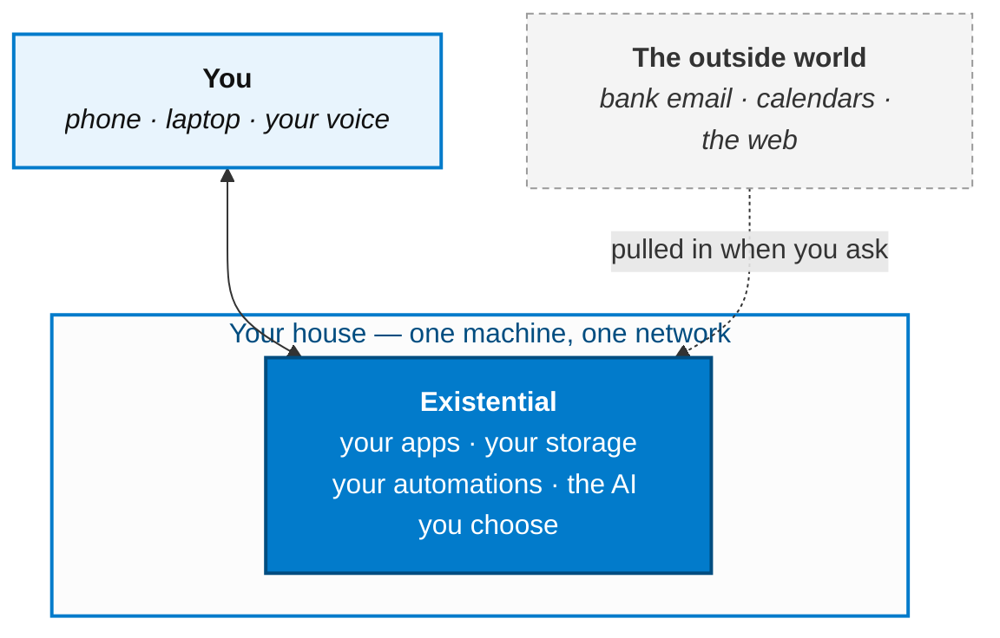

# What It Is

:::info[Level 1 of 4 · Context]
The system as one box — what it is and what it does for you. Zoom in one step at
[Level 2 · The Pieces](./how-it-works).
:::

**Your best brain day now accessible.**

Can't remember what you've forgotten? Change your environment to remember for you. Existential is that environment. It's just a notepad, until you tell it what to do.

Everything else on your phone surfaces what someone else decided needs your attention. This
surfaces what you decided. What you're building is your Diagram: the plan from your best day,
followed on the rest.

Underneath is a curated set of open-source apps (notes, photos, money, files, monitoring, home
automation) run as one system. Turn on what you want and it comes up wired together.

## What you get

- **Decisions run themselves.** A decision is a file, and it runs whether or not you remember it.
- **Plain files.** Everything you build is readable without Existential.
- **Your hardware.** No account, no subscription.

## What it looks like from outside



- **One system**, not twenty app addresses.
- **Nothing leaves** unless a routine you wrote sends it.
- **Everything inside is plain files** on your disks.

## The AI

Everything reaches the same model:

| You want to… | You get… |
|---|---|
| **Ask for something out loud** | A conversation, anywhere in the house, in a voice you chose |
| **Hand off a piece of work** | An agent that reads your notes and the web and files the answer back in your workspace |
| **Not do a chore again** | A routine that runs on a trigger and only speaks up when it matters |

All three use one OpenAI-compatible URL. Point it at a bigger model and all three change.
Which projects provide each piece: [Level 2](./how-it-works).

## What Core installs

The first `./existential.sh` builds **Core**. No GPU, no model downloads. Tailscale gives it
HTTPS on every device you log in.

| | |
|---|---|
| [code-server](./services/code-server) | Your work dir, `workspace/`, in a browser tab: editor, plus a terminal with `claude` and `opencode` ready |
| [Decree](./decree/) | Runs the automations in `workspace/.decree/` on a schedule or an inbox message |
| [ntfy](./services/ntfy) | How an automation tells you it finished, failed or is waiting for you |

Everything else is an add-on, one flow or one flag away: [Level 2](./how-it-works).

## Try it

Prerequisites: [Docker](https://www.docker.com/get-started/) usable without sudo, a machine to
host it, this repo, and, for Core, [Tailscale](https://tailscale.com/download) logged in on that
machine and on every device that should reach it.

```bash
git clone https://github.com/jtmckay/existential.git
cd existential

./existential.sh            # asks for a username and password, builds Core
docker compose up -d
```

Full walkthrough in [Getting Started](./getting-started).
