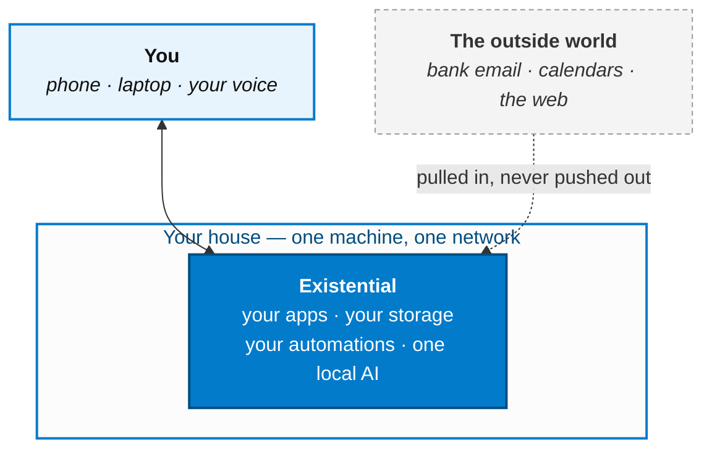

# What It Is

:::info[Level 1 of 4 · Context]
The system as one box — what it is and what it does for you. Zoom in one step at
[Level 2 · The Pieces](./how-it-works).
:::

**Taking your best brain day, and preserving it for your worst.**

Some mornings you wake up able to see the whole board. Most mornings you don't.
Existential is where the sharp you leaves orders for every other you, and makes sure
they're carried out.

Like Taravangian in *The Stormlight Archive*, who wrote the Diagram on his one genius day and
has followed it ever since, your sharp days write the plan and every other day runs it. And
nothing reaches you that you did not put there yourself.

Underneath it is a curated set of open-source apps (notes, photos, money, files, dashboards,
monitoring, home automation) run as one system: each with a name you can type, a certificate
your phone trusts, somewhere safe to put its data, a backup, and a way to reach the others.
You choose what you want; it comes up wired together.

## Three things it gets you

### Written down, not remembered
A decision is a file. It runs whether or not you remember making it.

### Solved once
Hostnames, HTTPS, backups, logs: figured out a single time, for every service after.

### Yours, physically
It runs on hardware you own. No account to lose, no subscription required, nobody who can lock
you out.

## What it looks like from outside



Three things worth noticing about that picture:

- **You talk to one system**, not to twenty apps you have to remember the addresses of.
- **The boundary is real.** Data comes in from outside; nothing goes back out unless you
  wrote a routine that sends it.
- **Everything inside the box is yours** — plain files, on disks you own, readable without
  Existential running at all.

## The AI is part of the plumbing, not a feature

Most stacks bolt an assistant on the side. Here it sits underneath, and everything reaches it
the same way:

| You want to… | You get… |
|---|---|
| **Ask for something out loud** | A conversation, anywhere in the house, in a voice you chose |
| **Hand off a piece of work** | An agent that reads your notes and the web and files the answer back in your workspace |
| **Not do a chore again** | A routine that runs on a trigger and only speaks up when it matters |

All three reach the same model, at one OpenAI-compatible URL. Swap what serves it — a bigger
model, a box with more VRAM — and all three change at once.

*Which projects actually provide this is [Level 2](./how-it-works). It's deliberately not on
this page: the pieces are replaceable, the shape isn't.*

## What Core installs

The first `./existential.sh quest` offers **Core**: open the work dir, talk to an AI about it,
have decree automate it. It runs on one ordinary box, with no GPU and no model downloads.

| | |
|---|---|
| [code-server](./services/code-server) | Your work dir, `workspace/`, in a browser tab: editor, plus a terminal with `claude` and `opencode` ready |
| [Decree](./decree/) | Runs the automations in `workspace/.decree/` on a schedule, a webhook or an inbox message |
| [ntfy](./services/ntfy) | How a finished automation tells you it finished |
| [Loki](./hosting/loki) · [Prometheus](./hosting/prometheus) · [Grafana](./hosting/grafana) | Every automation's run log, searchable, with dashboards |
| [Uptime Kuma](./hosting/uptime-kuma) | Whether the rest of your homelab is up |
| [Actual Budget](./services/actual-budget) | Budgeting, and the first app decree posts to |
| [Caddy](./hosting/caddy) · [Dashy](./services/dashy) | A name and a certificate for each of them, and one page linking to all of it |

Everything else (local models and agents, Nextcloud, voice and Home Assistant, more apps) is
an optional add-on, one quest or one flag away. What each piece does is
[Level 2](./how-it-works).

## Try it

Prerequisites: [Docker](https://www.docker.com/get-started/) usable without sudo, a machine to
host it, and this repo.

```bash
git clone https://github.com/jtmckay/existential.git
cd existential

./existential.sh quest      # pick your services
docker compose up -d
```

Full walkthrough in [Getting Started](./getting-started).
