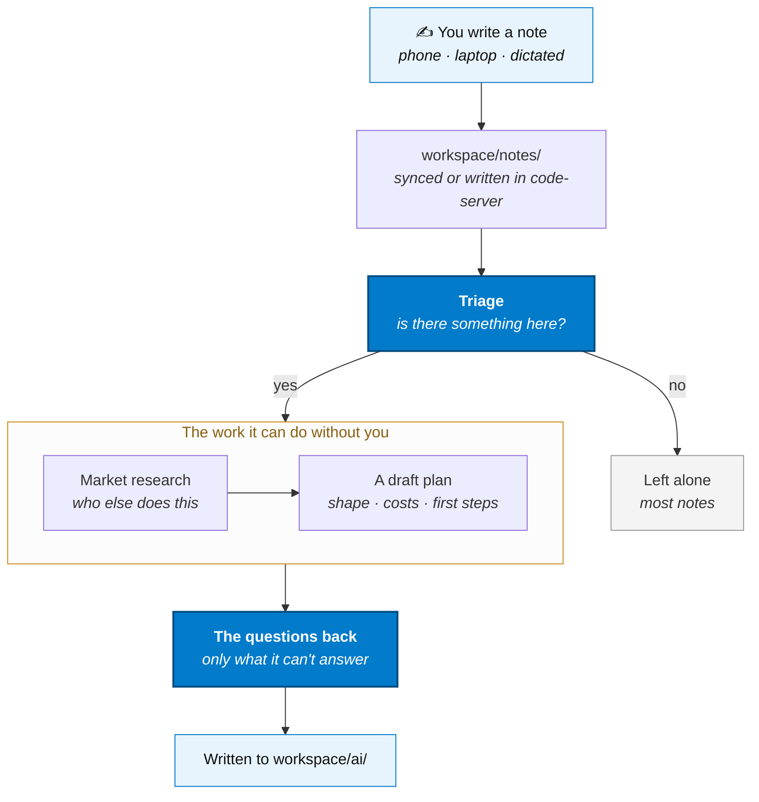

# Worked Example: Note → Action

Three machines in one flow, each part swappable. What it does for a person:
[Ideas That Get Followed Up](../flows/ideas.md). This page is how it is built, as a model for
your own: a cheap judgment first, the expensive work only for what passes.

## The pattern

```
  input  →  judgment  →  work  →  output
```

1. **Input.** A file, an email, your voice, a webhook, a schedule. Each becomes a message in one
   queue.
2. **Judgment.** One cheap question: is this worth acting on? Most things aren't.
3. **Work.** The expensive part, only for what passed: transcribe, research, extract, draft, file.
4. **Output.** A note, a task, a budget line, a notification, or another message.

Without the judgment, the expensive step runs on everything and you get a folder of unread
reports. Three of the four are settings, not code: the input is a trigger (a cron file, a
webhook, a file pattern), the judgment one line of prompt in cron frontmatter
(`TRIAGE_CRITERIA`), the work the name of the machine to chain (`TRIAGE_ROUTINE`).



## The four moves

### 1. Notes arrive

You write as usual, in `workspace/notes/`: in code-server, or anywhere the workspace syncs to.
`note_triage` reads it where it is (read-only to the automation container).

### 2. Triage — is there anything here?

`note_triage` asks one cheap question per note: **is there a real idea in this?**

- Only new and changed notes: the vault is hashed each run and diffed against the last.
- Keep it strict. A triage that passes everything produces a folder of unread reports.

### 3. Do what can be done unattended

For notes that pass, follow-up work is chained, each step its own message:

- **Market research**: who does this, what they charge, where the gap is.
  [Firecrawl](../ai/firecrawl.md) reads the pages.
- **A draft plan**: shape, rough costs, what must be true, first three steps.
- **Your own notes**: anything else in your vault that bears on it.

### 4. Come back with the right questions

The output ends with **the two or three questions whose answers change the conclusion**:

> *Does the licensing apply to resale? Is this a weekend project or the thing you leave your job
> for? The plan branches on that.*

They're written to `workspace/ai/note-develop/`, under the note's own path. Answer them and the next run picks up from there.

## The three machines

| Machine | Does | Swap it when |
|---|---|---|
| `note_triage` | Diffs `workspace/notes/` (`NOTES_DIR`), judges each new note, checks the ledger, chains the next step | Never |
| `note_develop` | *(default)* Researches and drafts one document | You want the fan-out |
| `idea_workup` | *(alternative)* Sends the idea to three departments | You want one document |

## Swap the judgment

`TRIAGE_CRITERIA` in the cron file decides what the flow is for:

```yaml
TRIAGE_CRITERIA: "a business idea — something the author could plausibly build, sell, or start"
```

If it fires too often, make it narrower: "a product someone would pay for that I could build a
first version of in a month".

## Is it new? The idea ledger

`/data/note-triage/ideas.tsv` lists every idea already processed. A passing note gets one more
call: is it the same as one on the list? Duplicates stop there.

```
2026-08-14T09:11:04Z	A tool-rental service for the neighborhood, booked from a phone
2026-08-22T17:40:55Z	A newsletter that summarizes local council minutes
```

Edit it freely; delete a line to let an idea through again.

`TRIAGE_LEDGER: false` chains every pass, duplicates included.

On an error or unclear answer the idea counts as new.

## Swap the work

`TRIAGE_ROUTINE` names what runs on a pass.

### `note_develop` — one document

The default. One file: what the idea is, what can be worked out, and two to four questions for
you. Needs only a chat model. Output goes to `workspace/ai/note-develop/`, and also to
`NOTE_OUTPUT_RCLONE_DEST` when that is set.

### `idea_workup` — three departments, three answers

```yaml
TRIAGE_ROUTINE: idea_workup
```

It emits three messages, each to the department with the right tools:

| Question | Department | Why |
|---|---|---|
| Who else is doing this? | `research` | Web access, Firecrawl, qmd |
| How big is the market? | `research` | Same tools, separate document |
| What is my value proposition? | `sales` | Pricing and positioning |

Each answer is its own file in `workspace/ai/`, with its own notification:

```
workspace/ai/tool-rental-competition.md
workspace/ai/tool-rental-tam.md
workspace/ai/tool-rental-value-prop.md
```

:::info[Why three messages]
A department carries only the tools its question needs, so a narrow one costs a fraction of
every tool in the prompt, and each question retries and logs on its own. See
[Routing to Departments](./routing.md).
:::

### Writing a third one

Write a machine, add it to `TRIAGE_ROUTINE`'s `enum` and the `emits:` list in
`automation/plugins/note_triage.md`, and name it in the cron file. It receives `note_path` and
`note_reason`. See [Writing a Plugin](./writing-a-plugin.md).

## Swap the input

Triage takes text and a name, so any input works. Only the first step changes.

```
<anything> ──▶ message ──▶ note_triage ──▶ ledger ──▶ idea_workup ──▶ departments
```

### Email

`gmail_sync` archives mail into `automation/emails/` (`/work/.decree/emails` in the container).
Point `NOTES_DIR` there and set the criteria to what you want caught. See
[Gmail](../integrations/gmail.md).

### A file you dropped somewhere

- In the workspace: a [file handler](./file-handlers.md) line in `.decree/handlers.yml`.
- Through Nextcloud: a file event reaches `file_router`, which matches a **file processor** by
  path and optional content gate:

```bash
PATTERN="^nextcloud:workspace/.*\.md$"
CRITERIA="a business idea"
```

See [File Change Processing](./file-change-processing.md).

### A sensor, or something you said out loud

A Home Assistant automation POSTs [automation-webhook](../decree/automation-webhook.md).

## Cost and pacing

- Decree runs one message at a time, and a department call can take up to 900 seconds
  (`agent_task`'s `agent_timeout`). A three-question fan-out can take most of an hour. Watch it in
  `volumes/workspace_data/.decree/runs/` or Grafana's **Decree Overview**.
- Triage is two short calls per note, only for new or changed notes over `TRIAGE_MIN_CHARS`.
  `TRIAGE_MAX_NOTES` caps a run.
